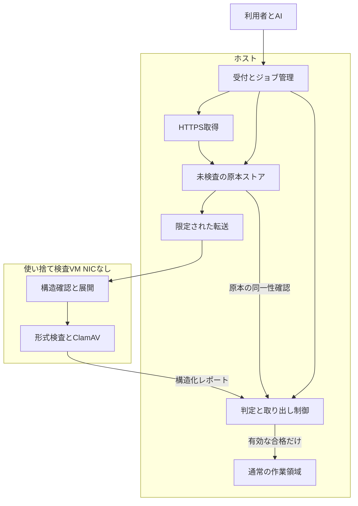

作成日 2026年10月27日　版 0.4.2　状態 実装・検証中

0.4.2では、実装の並行作業と段階0→1→2→3の受入判定を分離した。段階0が未通過の構成はPASS・取り出しを無効にする。期待ハッシュ、更新期限・再試行禁止期間、初回受付への固定、限定AV契約、取り出し中止、確認済みBLOCKの保持、容量強制と段階3完了後の顧客運用の条件は維持する。以下の試験は実装時の必須条件であり、本書の作成によって実行済みになったものではない。

顧客から受け取ったZIPやWebから取得したファイルを専用の受付に投入し、隔離VM内で検査してから通常の作業領域へ取り出すローカルツールを設計する。仮称は **FileGate** とする。

採用方針は、**受付とジョブ一覧を軽く動かし、検査時だけVMとウイルス検査エンジンを起動する構成**である。ウイルス検査にはClamAV、仮想化にはQEMUを再利用し、受付、検査の調整、判定、一覧、取り出しを実装する。

「合格（規定検査）」は、FileGateが明示した必須検査と受け入れ条件を満たしたという意味である。ClamAV内部の全シグネチャ評価・全制限到達・全解析中断を観測したことは保証しない。未知の危険の不存在を証明するものでもない。第6章の限定した検査プロファイルを結果に表示し、自動的にファイルを開く機能は設けない。

初期の参照構成を **Apple Silicon MacとARM64 Linuxゲスト**に置く。対象OSは実装開始時に確定する前提とし、WindowsとLinuxは同じ操作仕様を保つ別の実行アダプターとして拡張する。以下の資源量、容量制限、保持期間は設計初期値であり、実測値ではない。

# 1 目的と初期範囲

## 利用者ができること

1. AIに「このURLのZIPを取得して検査して」と依頼する。

2. 顧客から受け取ったローカルファイルを、画面またはコマンドから投入する。

3. 受付済み、取得中、検査中、合格、保留、遮断の一覧を見る。

4. 合格したファイルを、あらかじめ設定した取り出し先へ保存する。

5. 保留理由を確認し、定義ファイルの更新後などに同じ入力を再検査する。

「このページのZIP」という依頼では、AIがダウンロード用URLを特定し、FileGateに渡す。初期版のFileGateはHTTPSの直接ファイルURLを受け付ける。WebページのJavaScript実行やログイン操作は扱わない。

## 初期版の機能境界

| 項目 | 初期版の仕様 |
| --- | --- |
| 利用単位 | ローカル端末の単一ユーザー |
| 受付 | HTTPSの直接URL、ローカルファイル、画面からのアップロード |
| AI連携 | CLIを優先し、同じ内部APIをstdio MCPにも公開 |
| 一覧 | ローカルWeb UIとCLIの両方 |
| 検査 | 厳格なZIP検証、形式別の許可プロファイル、ClamAVによる静的検査 |
| 取得制御 | 有効な合格結果に対応する原本だけを設定済みの出力先へ取り出す |
| 同時実行 | URL取得・アップロード・ローカルコピーを合わせて1件。検査または更新のVMは合わせて1台。取り出しの書き込みも1件 |
| 未完了ジョブ | 取得待ちから最終判定までを合計20件以下。受付時に原本容量を予約 |
| 常駐 | 受付サービスだけ。検査VM・ClamAV・専用watchdogは必要時のみ起動 |
| 外部送信 | 検体、展開内容、検体ハッシュの外部解析サービスへの送信を設けない |

実行ファイルの動作観察、Officeの起動、文書のPDF化、メールの全添付自動回収、ブラウザーの全ダウンロード強制経由、組織向けの権限管理は後続機能とする。暗号化ZIPは初期版では保留し、ローカル画面からパスワードを入力して再検査する機能を後続に置く。

# 2 隔離の意味と保護範囲

## Pythonの仮想環境との違い

| 仕組み | 役割 | FileGateでの位置付け |
| --- | --- | --- |
| Python venv | Pythonと依存パッケージの分離 | セキュリティ境界には使わない |
| OSの仮想マシン | 別のOSで処理するための実行境界 | ファイルの展開と解析を隔離する基盤 |
| ウイルス検査エンジン | 定義や検出ロジックによる検査 | ClamAVを利用 |
| FileGate | 受付、隔離処理、検査完了確認、判定、一覧、取り出し | 利用者とAIの操作窓口 |

Python公式のvenvの説明は、独立したパッケージ環境の作成を対象としている。ファイルアクセスやネットワーク権限を分ける仕組みとして扱わない。[S1](https://docs.python.org/3/library/venv.html)

## 保護する境界

ファイルの内容を解釈する処理は検査VMへ配置する。ホスト側は上限付きのバイト転送、ハッシュ計算、保管、ジョブ管理、判定結果の検証、取り出しを担当する。

未検査のバイト列も物理的には端末の専用ストアに保存される。ここでいう隔離は、解析をVMに閉じ込め、通常の作業領域への出力をアプリ側で制御することである。ローカルファイルを投入した場合、投入元のファイルはそのまま残る。

同じログインユーザーが保存先を直接操作できる構成では、そのユーザーや同等権限の別プロセスのアクセスまで強制的に禁止できない。初期版は、利用者とAIがこの受付を通す運用を対象にする。AIに別途広いシェル権限を与えた場合、その権限による迂回をFileGateだけで禁止することはできない。

## 主要な脅威と対応

| 脅威 | 設計上の対応 |
| --- | --- |
| 展開器や解析器の脆弱性 | ハードウェア仮想化、共有フォルダなし、検査VMのNICなし、ジョブごとに破棄 |
| ZIPによる資源枯渇 | 実際の展開量、件数、再帰、時間、作業ディスクの上限 |
| 検査失敗を合格と誤認 | FileGateの必須検査とAVの観測範囲を分け、対象manifestと通常結果を照合。観測不能な内部処理は保証に含めない |
| 検査後の差し替え | 不変の原本と検査試行をSHA-256で対応付け、取り出し時に再照合 |
| AIやファイル名による操作の誘導 | 固定された操作だけを公開し、合格判定をサーバー側で強制 |
| 機密ファイルの外部送信 | 検体の外部解析機能を設けず、検査VMから通信経路を除去 |

解析器やゲストが侵害された場合、虚偽の結果を返す可能性は残る。ハッシュは入力の同一性を確認するもので、検査結果の正しさを証明するものではない。ホストOS、仮想化基盤、更新配布元は信頼する前提に置く。

# 3 システム構成



原本ストアから作業領域への出力は、必ず判定と取り出し制御を経由する。ゲストからホストの任意パスへ書き込む経路は設けない。

| 構成要素 | 採用案と責務 |
| --- | --- |
| ローカルサービス | Go。受付、容量予約、ジョブ調整、判定、取り出し、UI配信 |
| CLI | サービスとUnixドメインソケットで通信。JSON出力に対応 |
| MCPアダプター | stdio。CLIと同じ操作仕様を呼ぶ薄いアダプター |
| ジョブDB | SQLite。ジョブ、予約、検査試行、取り出し意図と復旧状態を保存 |
| 原本ストア | アプリ専用領域。表示名と保存名を分け、投入後の内容を変更しない |
| VMランナーとwatchdog | 固定引数でQEMUを起動し、ホスト資源監視とプロセス終了をUIやDB処理から独立して管理 |
| ゲスト | ARM64 Linux、検査ワーカー、StrictZipValidator、形式別アダプター、ClamAV |
| StrictZipValidator | ZIPの物理配置・ヘッダー・展開結果を独立検証。標準ライブラリーの読み取り成功だけでは受け入れない |
| UI | 静的な画面をローカルサービスから配信。外部CDNを使わない |
| 更新処理 | 検体を渡さない専用VM。定義は版固定のFreshClam制御アダプターで取得し、総deadlineとホスト上の再試行制御に従う |

初期版は、独立したRedis、常時稼働するDocker環境、外部データベースを必要としない構成にする。画面は受付、一覧、詳細の3つに絞り、デスクトップアプリ用の別ランタイムは追加しない。

# 4 検査VMの設計

## 実行基盤

参照実装はQEMUのARM64 virtマシンとmacOSのHVFを使用する。QEMUの公式セキュリティ方針は、対応マシンとハードウェア仮想化の組み合わせを対象としており、ARM64のvirtとHVFがこの構成に対応する。[S2](https://www.qemu.org/docs/master/system/security.html) [S3](https://www.qemu.org/docs/master/system/arm/virt.html)

HVFが使えない場合は起動失敗として保留する。TCGエミュレーションへの自動切り替えは設けない。採用するQEMUの安定版、マシン型、Linuxイメージ、検査ツールのバージョンとダイジェストを実装時に固定する。 起動前に第12章のwatchdog、プロセス識別、資源計測の可用性を確認する。監視できない場合はVMを起動しない。監視を省略して動かすモードは設けない。

## 起動時に固定する条件

- ネットワークデバイスを付けない。QEMUの `-nic none` を明示し、NIC、NAT、ブリッジ、ポート転送を構成しない。

- `-nodefaults` を使用し、起動と検査に必要な仮想デバイスだけを指定する。

- ホームディレクトリ、共有フォルダ、クリップボード、SSHエージェント、USB、認証情報を渡さない。

- セミホスティングとデバッグ用リモート接続を無効にする。

- QEMUを非rootで起動する。AIやゲストにQMPなどの管理チャネルを公開しない。

- ベースと定義イメージをQEMU側でもread-onlyにし、唯一の書込み可能ディスクを固定長4 GiBのrawにする。rootのOverlayFS upper/workも同じディスクへ置く。

- 検査VMの書込み可能領域は毎試行新規に作成し、ベースへ取り込まず終了後に破棄する。qcow2差分、QEMUの-snapshot、追加の書込み可能ディスク、実行中の容量拡張を使わない。

`-nic none` と `-nodefaults` はQEMUの起動仕様に従う。セミホスティングは有効化しない。QEMUの-snapshotは別の一時ファイルへ書くため、この構成では使わない。[S4](https://www.qemu.org/docs/master/system/invocation.html) 読取り専用イメージと固定rawの間のroot差分は、ゲストのOverlayFSで管理する。[S31](https://docs.kernel.org/filesystems/overlayfs.html)

### ジョブ作業ディスクの強制方式

検査VMへ公開する書込み可能ブロックデバイスは、**4,294,967,296 bytesのraw一つ**に限定する。ホストファイル長とrawノードのsizeを固定し、format=rawを明示する。ベースと定義は読取り専用デバイスとし、ゲストのmount指定だけに依存しない。ブロック構成・ファイル長・公開容量を検体転送前に確認し、不明な書込み先や拡張可能な別領域があれば起動失敗にする。[S30](https://www.qemu.org/docs/master/interop/qemu-qmp-ref.html#object-BlockdevOptionsRaw)

rawは事前に4 GiBを予約し、初期実装ではpreallocation=fullによる確保を採用する。この方式は事前書込みを伴うため、確保時間とI/Oを段階0で測定する。確保済み分を未書込み予約から差し引き、二重計上しない。full確保ができない環境で、別の可変長差分へ自動変更しない。[S30](https://www.qemu.org/docs/master/system/qemu-block-drivers.html)

ゲストの信頼済み起動処理でraw上にext4を用意し、root OverlayFSのupperdir/workdirをこの同じファイルシステムへ置く。copy-upされたOSファイル、ファイルシステムの管理領域・journalもこの4 GiBを消費する。[S31](https://docs.kernel.org/filesystems/overlayfs.html)

| 書込み先 | 配置と制御 |
| --- | --- |
| root差分、/etc、/var/log、/var/cache、/var/lib、必要なhome | 同じworkディスクのOverlayFS upperへ集約。別の書込み可能mountを作らない |
| VM内の受信partial・入力原本 | work上の/job/input。受信後は検査プロセスに対して読取り専用 |
| 展開、形式解析器、manifest、ワーカーレポート | /job/extract、/job/adapter-tmp、/job/metadata。すべて同じwork上 |
| ClamAV一時ファイル | --tempdir=/job/avtmpを固定。TMPDIR/TMP/TEMPも固定し、ライブラリーの別書込みもmount構成でworkへ収容 |
| /tmp、/var/tmp、/run、runtime journal、PID/socket | workディスク上。ディストリビューションの既定tmpfsへ無条件に置き換えない |
| /dev/shm | RAMの明示的例外。初期値size=64 MiB、nr_inodes=4096。ディスク4 GiBへは算入せず、ゲストRAMとホストwatchdogの対象 |
| initramfs、devtmpfs、/proc、/sys、匿名共有メモリ | 起動・カーネル・RAMの領域として別扱い。検査プロセスから保存先やmountを増やせないようにし、全RAMがディスク予算に含まれるとはしない |
| guest swap/core/dump、定義・パッケージ更新、書込み可能UEFI/TPM状態、VM保存状態 | 検査中は生成しない。固定kernel/initramfsの直接起動を採用し、未管理の永続状態を持たせない |

ClamAVのtempdirは一時ファイル先を指定するが、それだけで全書込み先を限定したとは扱わない。[S9](https://github.com/Cisco-Talos/clamav/blob/clamav-1.4.3/docs/man/clamscan.1.in) 検査プロセスを非rootにし、mount変更、追加tmpfs、ブロックデバイスの直接操作を許可しない。検体転送前にmount・block node・ホストで開く書込み先を許可表と照合する。tmpfsには容量とinode上限を与え、未制限のramfsを検査用保存先にしない。[S32](https://docs.kernel.org/filesystems/tmpfs.html)

4 GiBは**VMのディスク上の同時容量**であり、累積I/O、疎なファイルの論理サイズ合計、RAM、ホストDB・ログ・OS swap・APFS等の管理情報やsnapshotを含むホスト総消費量の上限ではない。削除と再利用による累積書込みは4 GiBを超え得る。本文を4 GiB保存できる保証でもなく、FS管理領域と停止余白の分だけ実際の利用可能量は小さい。

## ホストとゲストの転送

専用virtio-serialと所有者だけがアクセスできるUnixソケットを用いる。任意シェルや汎用ファイル操作を公開せず、入力転送、検査開始、結果取得に限定する。virtio-serialはQEMUがサポートするゲスト通信方式である。[S6](https://www.qemu.org/docs/master/interop/qemu-ga.html)

ホストが生成したジョブID、試行ID、入力サイズ、SHA-256、ポリシーダイジェストを開始メッセージに含める。ゲストは受信後のハッシュを照合してから解析する。入力はチャンク転送し、全体をメモリに載せない。

結果は固定スキーマのJSONで返す。最大32 MiB、エントリー最大10,000件、文字列長とネスト深さにも上限を設ける。ホストは不明な必須状態、件数不一致、異なるハッシュ、不正なJSONを有効なレポートとして受理しない。確認済み拒否根拠がなければHOLDとし、同一試行ですでに永続化した拒否根拠があればBLOCKを保持する。ゲスト由来の文字列をコマンド、ホストパス、SQL、HTMLとして扱わない。

検査後はゲストから原本を返さず、ホストが保持した入力を取り出す。これにより、侵害されたゲストによる出力ファイルの差し替え経路を減らす。

# 5 受付から取り出しまで

## URLからの受付

1. CLIまたはMCPが直接URL、期待する形式、受付用idempotency keyを送る。サービスは未完了数と容量を原子的に予約した後でジョブIDを返す。

2. 共有の取得枠を確保した処理だけがHTTPS応答を受信する。最終ステータスとヘッダーを検証し、上限付きで一時ファイルへ保存する。

3. HTTPメッセージの完全受信、サイズ、SHA-256を確認する。原本のファイル確定とDB更新は別操作として第10章の順序で処理し、予約を実サイズへ精算して検査待ちにする。

4. 有効な定義ファイルと実行環境を確認し、検査VMを起動する。

5. VM内で形式判定、ZIPの構造確認と展開、形式別の検査、ウイルス検査を行う。

6. ホストがレポートを検証し、確認済み拒否根拠があれば直ちに永続化する。VM終了まで実行状態を管理し、全条件を満たして終了した場合だけPASSを確定する。

7. 合格したジョブだけが取り出し可能になる。利用者またはAIの取り出し操作で原本を出力する。

取得プロセスはホストで動くが、ZIPを展開したり、PDF、画像、Office文書、HTMLの内容を解釈したりしない。ダウンロード時点からVM内に置く方式は、取得専用VMを追加する拡張とする。

## URL取得の制約

HTTPS、原則443番ポート、最大5回のリダイレクトに限定する。ループバック、私設アドレス、リンクローカル、クラウドのメタデータ用アドレスなどは接続先に認めない。IPv4、IPv6、IPv4を表すIPv6を同じ規則で判定する。

DNS解決後に接続先を検証し、その接続では検証したIPを使用する。ホスト名によるTLS検証は維持する。リダイレクトごとに同じ確認を行い、HTTPSからHTTPへの変更を拒否する。これらはSSRF対策として実装する。[S7](https://cheatsheetseries.owasp.org/cheatsheets/Server_Side_Request_Forgery_Prevention_Cheat_Sheet.html)

ブラウザーのCookie、OSの認証情報、環境変数のプロキシ設定を暗黙に引き継がない。認証付きサイトは初期対応外とし、署名付きの直接URLは通常の取得条件を満たす場合に受け付ける。URLのクエリや認証情報を通常ログへ残さない。

### HTTP取得成功の条件

外部URLの最終応答は **200 OKだけ** を受け入れる。リダイレクトは上記の宛先・回数制約を満たした場合に限る。206、201、202、204、304、4xx、5xx等は取得失敗とし、エラー本文を原本として検査へ渡さない。200でもContent-Rangeがあれば拒否する。Range要求、途中再開、分割結合は初期版に含めない。GoのClient.Doは非2xxだけでは通信エラーを返さないため、明示的にステータスを検査する。[S25](https://pkg.go.dev/net/http#Client.Do)

Accept-Encoding: identityを指定し、HTTPライブラリーの透過的な圧縮展開を無効にする。Content-Encodingは未指定またはidentityだけを許可する。Content-Lengthがあれば妥当性と250 MiB以下を確認し、受信後の実サイズとの一致を要求する。長さの申告にかかわらずストリームを250 MiBで制限し、超過、read error、無通信30秒、全体120秒で中止する。

正常なメッセージ終端を確認する。HTTP/1.1では有効なContent-Lengthに対応する完全な本文、または正常なchunked終端を必要とし、接続切断だけで終端を決める応答はHOLDにする。HTTP/2では正常なstream終端をHTTPライブラリーに確認させる。途中切断・不正chunk・長さ矛盾を取得失敗にする。HTTP/1.1のTransfer-EncodingとContent-Length併記は拒否対象とし、採用HTTP実装がヘッダーを正規化する前に検知できることを段階0で確認する。確認できなければ、検証済みのヘッダー検査層を追加するまで当該取得経路を有効にしない。close-delimited応答では正常終了と途中障害を区別できないことがRFCにも示されている。[S25](https://www.rfc-editor.org/rfc/rfc9112.html#section-6)

URL受付ではexpected_typeを必須とし、「ZIPを取得」ならzipを記録する。実体の形式確認はVM内で行い、200で返ったログイン画面や説明文も期待と異なればUNEXPECTED_ARTIFACT_TYPEでHOLDにする。MIME未指定とapplication/octet-streamは形式不明の申告として扱う。expected_sha256が指定された場合は一致も要求する。HTTPの完全受信は、配布側が意図した全内容や真正性を単独で証明しない。

Content-Dispositionの名前は表示専用であり、保存先には使わない。取得失敗はphase=FAILED、verdict=HOLDとして理由を記録し、不完全な本文を検査しない。FileGate自身の受付APIが返す202 Acceptedは、外部ダウンロードの成功条件とは別である。

### 取得枠と原子的な容量予約

URL取得、UIアップロード、CLIによるローカルコピーは、単一のingest枠を共有し、合計同時数を1にする。受付から最終判定までの未完了ジョブは合計20件以下とする。サイズの分からない入力も扱えるよう、初期版は入力ごとに最大250 MiBを先に予約する。

SQLiteのBEGIN IMMEDIATEトランザクションで、受付用キーとrequest_fingerprintの照合、未完了数、5 GiBの原本予算、intake_request・job・reservation・取得所有者の作成を一緒に処理する。同じ空き容量を複数要求が予約できないようにする。既存キーへの再送は新しい枠・予約を取る前に第8章の規則で処理する。予約・キーのトランザクションが未確定のまま枠不足・容量不足で拒否された要求は、キーを消費しない。URLジョブは予約後に待機できる。アップロードとローカルコピーは予約とingest枠を得るまで本文を読み込み・スプールしない。枠がなければRESOURCE_BUSY、容量不足ならQUOTA_EXCEEDEDを返し、その要求を受付済みにしない。予約の精算・復旧は第10〜11章に従う。

## ローカルファイルからの受付

ファイル選択または許可された入力ディレクトリから、サービスが読み取り専用でコピーする。シンボリックリンクと特殊ファイルを拒否し、コピー中のサイズ上限を適用する。原本ストアの確定後は、投入元が変更されてもストア側の内容を変更しない。原本のSHA-256とbyte_sizeは実際に完全受信したバイト列から確定し、パス・表示名・申告値だけから内容の同一性を推定しない。URL取得・初回ローカル取込み・初回アップロードの全受付経路で、任意指定のexpected_sha256がある場合は完全受信後の実測SHA-256と必ず照合し、不一致ならINPUT_HASH_MISMATCHとして検査待ちへ進めない。

投入元の移動や削除は行わない。ブラウザーやメールから既に保存したファイルでは、投入前に端末へ存在していたことを前提に運用する。

### 最初の受付と再送の範囲

受付用キーは、最初に永続化した受付要求とjobへ固定する。同じキー・同じ受付メタデータの再送は、その受付の現在状態を照会する操作とする。ローカルパスを再度開かず、アップロードの再送本文も取り込まず、元の取得を再開・置換しない。URLも同じキーでは再取得しない。

同じパスの内容がAからBへ変わった場合や、同名のアップロード本文が変わった場合、本文変更自体を再送時に検出する契約にはしない。元の受付が確定済みならAのjob・object・hash・sizeを返し、replayed=true、current_input_checked=false、body_consumed=falseを必ず示す。今回のBを取得・比較・検査した意味ではない。変更後の内容、または失敗した取込みを新たに取得するには、新しいキーを使用する。

初回が取得中・復旧照合中なら同じjobと未確定状態を返し、失敗・キャンセル済みなら元の終端状態を返す。初回が未確定であることを理由に、再送されたBをAの続きを埋める本文として使用しない。比較対象、応答とHTTP本文を読まない制御は第8〜9章に定める。

## 取り出し

取り出しはrelease_idと必須のidempotency keyで管理する。新たに出力する直前に、有効な合格結果、入力ハッシュとサイズ、出力先の許可を確認する。同じURLからの再取得は行わない。出力前に原本・検査試行・固定の出力名をDBへ永続化し、以後は同じ取り出し意図へ収束させる。 公開前に終える場合はrelease_idを指定した取り出し中止を使う。取得・検査のcancel_job、原本削除、公開済みファイルの回収とは別の操作である。

出力先と同じファイルシステム内の専用一時領域へ排他的にコピーし、ハッシュとサイズを照合してから、既存ファイルを上書きしない原子的な名前変更で固定名へ公開する。シンボリックリンクを追従せず、出力名にrelease_idを含め、確定形式と矛盾する拡張子を使わない。ファイル公開とSQLiteの成功記録は別操作である。公開後・DB確定前に停止しても同じ出力を照合して復旧し、別名を追加しない。第10章に通常手順と復旧表を定める。

参照構成の既定の取り出し先は `~/Downloads/FileGate` とし、初期設定で変更できる。AIは設定済みの取り出し先だけを選べる。任意の絶対パスやシェルコマンドは受け付けない。合格後にAIが取り出すための追加の手動承認は必須にせず、サービス側の条件で制御する。ファイルを開く操作は自動実行しない。

# 6 判定と状態管理

## 判定の定義

| 判定 | 意味 | 取り出し |
| --- | --- | --- |
| PASS 合格（規定検査） | 検査時点のFileGate必須検査と限定AVプロファイルの受け入れ条件を満たした | 現在のrelease_eligibilityがtrueの場合のみ可 |
| HOLD 保留 | 確認済み拒否根拠がなく、未対応・必須検査不完了・上限超過・実行異常などで受け入れられない | 不可 |
| BLOCK 遮断 | 検証して永続化したマルウェア検知や危険構造の拒否根拠がある。実行失敗・キャンセルでも保持 | 不可 |
| UNDECIDED 未確定 | 受付中または検査中 | 不可 |

遮断と感染を同じ表示にしない。例えば、不正なパスによる遮断とマルウェア検知による遮断を別の理由コードで表示する。実行形式やマクロなど、初期ポリシーで対応しない内容は保留とする。

本書の各表で「上限超過・異常時はHOLD」とする記述は、同一試行に確認済みの拒否根拠がない場合を指す。確認済みBLOCKを実行異常によってHOLDへ降格させない。判定と処理状態の優先規則は下記に従う。

## 合格の必須条件

- ホストが保持した原本と、ゲストが検査した入力のサイズとハッシュが一致する。

- すべての対象が有効な形式アダプターの対応範囲に入り、禁止構造や保留条件に該当しない。

- FileGateの対象manifestと必須検査記録が対応し、欠落・形式検査エラー・FileGate自身の上限超過がない。AV対象manifestと対象ごとの通常結果も一致する。件数一致はエンジン内部の全評価完了を証明しない。

- ClamAVプロセスが正常終了し、マルウェア検知、観測できた暗号化・制限・解析異常の通知、解釈できない結果がない。標準CLIで観測できない内部条件は、下記の限定プロファイルの対象外とする。

- 使用した定義、エンジン、PCREライブラリー、ビルド設定、ワーカー、ポリシーと観測仕様が、有効な版・ダイジェストに一致する。

- 検査VMが終了し、入力が不変の原本ストアに存在する。

ClamAVには、サイズ上限を超えたファイルをスキップしてclean扱いにする動作がある。このため、終了コード0や「OK」の文字列だけでは合格にしない。[S8](https://docs.clamav.net/manual/Usage/Scanning.html)

### ClamAVで保証する範囲と観測行列

標準clamscanを使う初期版は、AVの内部処理をbest effortとして扱う。--alert-exceeds-maxは一部の制限を通知する機能であり、全内部制限の検出保証には使わない。確認したClamAV 1.4.3では、PCREのmatch/depth上限がdebugメッセージだけになり、呼び出し側へエラーとして伝わらない経路がある。エラーの一部を成功状態へ正規化するコードもある。[S14](https://github.com/Cisco-Talos/clamav/blob/d8b053865fd5995f7af98bfbcd98c9a5644bfe2b/libclamav/regex_pcre.c#L159-L180) [S15](https://github.com/Cisco-Talos/clamav/blob/d8b053865fd5995f7af98bfbcd98c9a5644bfe2b/libclamav/scanners.c#L4165-L4206)

| 条件群 | 検出経路と必須扱い | 初期版の保証範囲 |
| --- | --- | --- |
| 入力・展開サイズ、件数、深さ、比率、形式・ZIP構造 | FileGateの独立カウンターと検証器。超過・未完了はHOLD | 必須。実測値と境界試験で確認 |
| ワーカーで検出した読取り失敗、AV通常結果に報告された読取り失敗、プロセスのtimeout・異常終了・結果欠落・未知の通常出力 | 外側のdeadline、終了状態、対象IDごとの結果照合。異常はHOLD | 必須。終了コードだけに依存しない |
| ClamAVが通常結果へ報告するサイズ・再帰・件数・時間制限、暗号化等 | 採用版のフラグと通知名を観測仕様へ固定。認識した通知はHOLD | 報告経路を確認した条件に限る。同名の設定でも全内部経路を観測できるとはしない |
| PCREのmatch/depth上限 | 確認版には通常結果で観測できない経路がある | 内部評価完了の保証外。debug出力の不在を完了証拠にしない |
| PCREの対象サイズ、bytecode timeout、埋め込み形式・正規化器の各内部上限、内部parse/read/unpackの打切り | 確認済みのソース分類と再現fixtureを保持し、通常結果に報告された異常はHOLD | 確認済みの観測限界と、独立確認していない内部経路を区別する。後者は明示採択した範囲に限り標準エンジンのbest effortとして扱い、内部処理の完了・制限通知を保証しない |
| マルウェアとして報告された検知 | 正規化した検知種別と対象ID | BLOCK。制限ヒューリスティックと感染を区別 |

この表は契約の骨格であり、採用バイナリーについて検証済みという意味ではない。段階0で、FileGateの独立した必須検査とAV通常結果の受入条件について「条件・閾値・確認したソースの経路・通常出力/終了状態・fixture・期待判定」を対応付けた機械可読の観測行列を確定する。source commit、binary digest、build options、PCRE版、設定digest、定義digest、worker imageを行列に結び付ける。既存の内部制限・成功への正規化の分類と実測は保持し、独立確認していない内部経路は別の一覧へ明示する。この一覧は観測不能を立証した記録とは区別し、未確認範囲と失う保証をユーザーが明示採択してから採用版へ結び付ける。通常結果に現れる異常、FileGateの必須検査、定義の真正性・版・ハッシュ・鮮度の確認は、この一覧を理由に省略しない。

**採用AVプロファイルを有効にする前に**、この行列と未独立確認範囲を固定し、無害な署名・入力によるPCRE上限等の実現性試験と、通常結果の正規化・対象対応・timeout停止の検証を完了する。既存の同一条件・同一版の証拠は再利用してよい。内部経路を独立確認していないことは、通知を伴わない内部の打切りや成功への正規化を検出できない可能性として受け入れるのであり、その経路の安全性・内部処理完了を確認したことにはしない。標準CLIで観測できない条件を含めて「どの内部制限でも必ずHOLD」を要求する運用には本プロファイルを提供しない。無害な入力の反復成功を、未独立確認の内部経路や全入力に対する保証へ読み替えない。

段階0の実験ゲートは、採用AVの観測契約、HTTP取得、仮想化チャネル、ホスト資源監視・終了、更新総期限と版固定のFreshClam制御状態アダプターの実現性を対象とする。FileGate独自の必須チェックとfixtureは段階0で仕様を確定し、StrictZipValidatorは段階1、追加形式アダプターは段階2の終了条件として実装・実証する。

結果スキーマはrequired_checks_complete、av_process_status、av_result、av_coverage_assuranceを分ける。初期値のav_coverage_assuranceはstandard_engine_best_effortとし、profile_idと既知の観測限界IDを併記する。coverage.completeや「全署名評価済み」に相当する値は返さない。観測不能なPCRE制限の可能性だけで全入力を保留にする仕様ではなく、その限界を明記した契約で判定する。

manifestでは、コンテナー、検証済み空ディレクトリ、通常ファイルを区別する。AV対象は原本と、ネストしたコンテナーを含む展開済み通常ファイルの各実体IDであり、StrictZipValidatorがVERIFIED_EMPTY_DIRECTORYと確定したentryだけをAV対象から除外する。全entryを構造検証・entry数予算に含め、除外entryにもkind=verified_empty_directoryとav_exclusion_reasonを残す。0バイトの通常ファイルはAV対象に含める。OOXML内部partも形式アダプターが役割を検証し、対象manifestに記録する。親コンテナーの内部でClamAVが再解析した件数は、外側の対象数に加算しない。通常結果の件数は対象IDへの対応を確認するために用い、ClamAV内部での検査量を表すものとして表示しない。

## 処理状態と結果を分ける

処理状態は次の順序で進む。

```text
QUEUED → ACQUIRING → QUEUED_FOR_SCAN → PREPARING → INSPECTING → FINALIZING → FINISHED
```

QUEUEDは取得待ち、QUEUED_FOR_SCANは原本確定後の検査待ちである。phaseは進行と終了理由、verdictは内容について確立した判定として独立に保存する。終端phaseはFINISHED、FAILED、CANCELLEDであり、FAILED/CANCELLEDにverdict=HOLDを無条件に割り当てない。CLI/MCPの待機期限はジョブ状態を変えない。更新を待つジョブはQUEUED_FOR_SCANを保ち、wait_reason=DEFINITION_UPDATEとupdate_idを別に持つ。更新失敗・COOLDOWN・UNKNOWN時の終端化は第11章に従い、待機列に無期限で残さない。

### 確認済み拒否根拠と実行異常

ホストは完結したレポートについて、スキーマ、job/attempt/objectの対応、入力hash/size、対象ID、検査プロファイル、検知種別と内部整合性を確認する。通常の検査終了経路では、受理した有効な拒否根拠をrejection_evidenceへ同期コミットしてからVM停止処理へ進む。資源・監視異常の緊急停止はコミットを待たずに行い、すでに永続化した拒否根拠は保持する。未保存・未検証の報告から確認済みBLOCKを推定しない。証拠ID、報告digest、対象ID、固定のreason_code、検査根拠の識別、検証時刻を持たせる。単なるstdoutの検知文字列、途中で切れたJSON、別入力の結果、矛盾したレポートは確認済みとしない。

execution_errorsとキャンセル理由は別に追記する。同一試行で確認済みの拒否根拠は、後続の停止失敗・timeout・cancel・再起動で削除しない。未検証の追加レポートが来ても、先に正常に確認した別の証拠を消さない。確定済み試行を再解釈して上書きせず、再検査は新しい試行として扱う。

| 処理状態と証拠 | verdict・取り出し | 表示例 |
| --- | --- | --- |
| 確認済み拒否根拠あり、通常終了 | BLOCK、不可 | 遮断：マルウェア検知 |
| 確認済み拒否根拠あり、FAILED/CANCELLED | BLOCKを保持、不可。実行異常も保存 | 遮断：マルウェア検知／終了処理失敗 |
| 拒否根拠なし、FAILED/CANCELLED | HOLD、不可 | 保留：検査中断 |
| レポート自体が無効、他に確認済み根拠なし | HOLD、不可。検知済みとは表示しない | 保留：結果検証失敗 |
| 拒否根拠なし、全必須条件を満たしてFINISHED | PASS候補。現在のeligibilityを別評価 | 合格（規定検査） |
| 非終端、確認済み拒否根拠あり | BLOCKは表示できる。終了処理は続け、取り出し不可 | 遮断：マルウェア検知／終了処理中 |

BLOCKの保持は、ゲストの報告が真実であることの新たな保証を加えるものではない。第2章の信頼範囲と第6章のレポート検証契約に従い、確認した拒否根拠を実行異常で失わないための規則である。

確定済み検査試行の判定・検査根拠は書き換えず、再検査では新しい試行IDを作る。終了後の回収経過は別の実行管理記録とイベントへ保存する。以前のPASSがあっても、新しい必須検査が未完了の場合は取り出せない。

## 有効期限と再検査

合格結果による現在の取り出し許可は初期値24時間とする。期間内でも、ポリシー、ワーカーイメージ、エンジン、ビルド・設定、定義、形式プロファイル、観測行列のダイジェストが変われば再検査を要求する。過去のscan_attempts.verdictは書き換えず、release_eligibilityとその理由を別に計算する。

定義ファイルの鮮度は別に評価する。検査開始時点で、公式配布元に対する更新確認が24時間以内に成功していることを要求する。定義の公開日時、更新確認日時、検証結果を別々に記録する。古い定義を再び読み込んだだけでは鮮度条件を満たさない。FreshClamの終了コード0、cooldown中の処理省略、429後の成功への正規化も更新確認成功として数えない。必須の全定義について配布元確認と成果物検証が成功した証拠を第11章の更新アダプターから受け、ホストで検証した場合だけ鮮度を更新する。

失効した結果は、一覧でも「再検査が必要」と表示する。過去の判定は履歴に残し、現在の取り出し可否とは分ける。既に取り出したファイルを後から回収する機能は初期版に含めない。

# 7 ZIPとファイル形式の扱い

## ZIPの構造検査

ZIPの受け入れ判定は、VM内の**StrictZipValidator**が担当する。Goのarchive/zipは対応する圧縮データを読むために再利用できるが、読み取り成功だけでは厳格な構造検証にならない。確認したGo実装には、local/centralの名前を比較しない処理、descriptorなしで記録CRCが0の場合に照合を省く処理、descriptorのサイズを使わない処理がある。[S16](https://go.dev/src/archive/zip/reader.go)

初期対応をFileGate ZIP32 Profile 1として固定する。Store/Deflate、単一ディスク、非暗号化、ASCIIまたは曖昧さのないUTF-8名に限定する。ZIP64、SFX/prefix、末尾付加データ、追加record、file/archive comment、未対応extra fieldはHOLDとする。data descriptorは署名付き32-bit形式だけを許可し、bit 3がある場合のlocal headerのCRC・サイズはすべて0のplaceholderに限定する。extra fieldは既知の時刻情報等について長さ・重複・解釈を定義して試験したものだけを許可し、名前を上書きする未知の拡張は無視しない。基準となる構造仕様はPKWARE APPNOTEとする。[S17](https://pkware.cachefly.net/webdocs/casestudies/APPNOTE.TXT)

| 検査 | 実装責務 |
| --- | --- |
| ヘッダー照合 | 独立にlocal header、central directory、EOCD、必要なdescriptorを読む。raw name、method、flags、必要version、CRC、サイズ、構造に関係するextraを照合。descriptorありではplaceholder規則に従い、descriptor・central・実測値を照合 |
| データ範囲 | 全offset/lengthのoverflowと入力範囲を検査。entry区間の重複、同じlocal headerへの重複参照、CDへの食込みを拒否 |
| 未参照領域 | 許可されたlocal entry区間、CD、EOCDでファイル全体を説明する。prefix、gap、未参照record、EOCD後の領域をHOLDにする。圧縮データ内の署名文字列をrecordと誤認しない |
| 展開結果 | 実サイズとCRC32をストリームで計算し、記録CRCが0でも必ず比較。正しいCRCが0である入力は受け入れ可能 |
| Deflate終端 | 指定圧縮範囲で単一streamが完全に終了し、余分な圧縮バイトや連結streamが残らないことを確認。先読みを制御できるbounded ByteReader等で消費量を計測 |
| 種別・空ディレクトリ | 名前、CreatorVersion、ExternalAttrs、圧縮方式、サイズ、CRC、物理payloadを独立検証し、下記条件を満たすentryだけAV除外 |
| パス階層 | 正規化した要素でコンテナーごとの階層木を作り、通常ファイルと暗黙・明示ディレクトリの衝突を入力順序によらず拒否 |
| 標準APIとの境界 | 独立manifestと標準APIのentry/offset/sizeが一致してからデコードを利用。path・容量監視も独自に実施。未実装の検査を寛容なAPIへの切替で省略しない |

このプロファイルに入らない有効なZIPもHOLDになる。対応する通常の日本語名・作成ツールのZIPをfixture化し、互換性を実測してから許可範囲を増やす。

### ディレクトリの検証とAV除外条件

GoのModeはCreatorVersionに応じてExternalAttrsを解釈し、名前末尾の/も参照する。一方、File.Openは末尾/かつ申告展開サイズ0なら圧縮データを読まずEOFを返す経路がある。IsDir、末尾/、OpenのEOFのどれかだけで空ディレクトリと判断しない。[S27](https://go.dev/src/archive/zip/struct.go) [S16](https://go.dev/src/archive/zip/reader.go)

初期ZIP32 Profile 1でVERIFIED_EMPTY_DIRECTORYとするには、次を**すべて**必要とする。

- local/centralのraw nameが一致し、安全な相対パスで末尾が/である。

- 対応するcreatorの型属性がdirectoryを表し、名前・他の既知型属性と矛盾しない。

- methodはStore、data descriptorなし、local/centralの圧縮サイズ・展開サイズ・CRC32がすべて0である。

- 独立した物理配置検査でもpayload区間が0バイトであり、隠れた領域や未参照データがない。

| creatorと属性 | 初期の分類規則 |
| --- | --- |
| Unix / macOS | ExternalAttrs上位のPOSIX種別を必須とする。directoryなら末尾/、regularなら末尾/なしを要求。DOS directory bitが立っていればPOSIX directoryとの一致を要求し、regularとの併存はHOLD。directoryでDOS bitがない場合は未指定として許可する |
| FAT / VFAT / NTFS | DOS directory bitと末尾/の有無を一致させる。上位の未対応型情報、volume label、未知の属性はHOLD。許可するreadonly/hidden/system/archive等の属性マスクを固定する |
| 未対応creator・種別未指定・解釈不能 | HOLD。通常ファイルにもdirectoryにも推定分類しない |
| 既知のsymlink・特殊ファイル | 従来どおりBLOCK。directoryへの読み替えはしない |

名前・属性・実データの矛盾はHOLDにする。directory属性なのに末尾/なし、末尾/なのにregular、非空データ、圧縮された空directoryも初期版ではHOLDである。全構造の検証を終えてからAV除外を確定する。互換性を広げる場合も、この条件を省略せずプロファイルとfixtureを更新する。

### パス階層の整合性

コンテナーごとに、受け入れたパスを要素へ分解し、大文字小文字・Unicode正規化の衝突規則を各階層へ適用した木を構築する。通常ファイルを他entryの祖先にする構造をARCHIVE_PATH_TYPE_CONFLICTでBLOCKにする。ID名で実ファイルを展開できても、この論理階層の検証を省略しない。

| 組合せ | 初期判定 |
| --- | --- |
| 通常ファイルaとa/b.txt | BLOCK |
| 通常ファイルaと明示directory a/ | BLOCK |
| 通常ファイルAとa/b.txt、Unicode正規化後に同じ祖先となる組合せ | BLOCK |
| 検証済み空directory a/とa/b.txt | 許可候補 |
| a/b.txtとa/c.txt | 暗黙directory aの共有として許可候補 |
| 子entryで生じた暗黙directoryに一つの明示directoryが対応 | 正常な統合として許可候補。明示entryの重複とは区別 |
| 同じ正規化キーの明示directoryが複数 | BLOCK |

全entryを集約してから分類する。順番を逆転させても同じ結果になることを要求する。

展開先の実ファイル名にはワーカーが発行したIDを使い、ZIP内のパスをそのまま書き込み先に使用しない。ただし、取り出す原本ZIPに危険な名前が残らないよう、元のエントリー名も検証する。

次を明確な拒否条件としてBLOCKにする。

- 相対パスの遡り、絶対パス、ドライブ指定、UNC、NULなどの危険なパス表現。

- シンボリックリンク、ハードリンク、デバイスなどの特殊ファイル。

- 同名エントリー、大文字小文字・Unicode正規化による名前の衝突、通常ファイルと暗黙・明示ディレクトリの階層衝突。

- 対応する展開環境で別のパスとして解釈される不正な名前。

破損、CRC不一致、ヘッダー・descriptor・種別属性・実データの矛盾、範囲の重複や未参照領域、暗号化、未対応の圧縮方式・extra fieldはHOLDにする。上記の不正パス・リンク・名前・階層衝突はBLOCKとする。自己解凍形式や別形式との複合を含むプロファイル外のZIPを、標準APIで読めたことを理由に自動合格させない。

StrictZipValidatorは外側のZIP、ネストZIP、対応するOOXMLのZIP構造に共通で適用する。これらの内部ファイルを一つの資源予算で数え、ヘッダーの申告値だけでなく実際の展開量を計測する。一つの実体を複数アダプターが参照しても二重展開せず、展開バイトは一度だけ計上する。archive_entry_count、extracted_file_count、required_av_input_countを分け、ClamAV内部の展開件数との一致は要求しない。圧縮爆弾の制限を無効にして通す操作は公開しない。

## 形式ごとの初期方針

| 形式 | 自動合格に必要な検査 |
| --- | --- |
| ZIP | ZIP32 Profile 1の全体構造、全entryの対応確認、展開上限、原本と展開対象のAV検査 |
| TXT | 許可するテキスト形式の確認とAV検査。取り出し時もtxtとして扱う |
| JPEGとPNG | 対応アダプターによる構造確認とAV検査 |
| PDF | 対応アダプターとAV検査。暗号化、既知のスクリプト、自動アクション、添付などの保留条件を確認 |
| DOCX | ZIP構造と全partの許可検証、マクロ・外部relationship・OLEの保留、全フィールドHOLD、AV検査。下記のフィールドなしプロファイルを確立してから有効化 |
| PPTX | ZIP構造、内部XML、マクロ、外部relationship、埋め込みOLE等を対応プロファイルに沿って検査し、AV検査 |
| XLSX | 下記のデータのみの許可プロファイル、ZIP構造、全partの検証とAV検査。数式・名前定義・接続等はHOLD |
| CSV | 初期版はHOLD。表計算ソフトでの数式解釈への対応を別途実装してから許可 |
| 旧Office形式、マクロ有効形式、実行ファイル、スクリプト、インストーラー | 初期ポリシーではHOLD |
| 暗号化ZIP、RAR、7z、不明形式 | 初期版はHOLD |

PDFとOfficeの形式アダプターは、対応範囲と必須検査を宣言する。必要な解析器が未実装、無効、異常終了の場合は、その形式の自動合格を有効にしない。初回の試作ではZIPとTXTから開始し、受け入れ試験に合格した形式を順に追加する。

### XLSXのデータのみの許可プロファイル

外部relationshipの不在だけで外部取得がないと判断しない。IMAGE関数はHTTPSの画像取得元を受け取り、Mac版Excelも対応する。数式はワークシートXMLのf要素に保存され、vのキャッシュ値があっても数式がなくなったことにはならない。[S18](https://support.microsoft.com/en-us/excel/functions/image-function) [S19](https://learn.microsoft.com/en-us/office/open-xml/spreadsheet/working-with-formulas)

初期版は安全な関数の許可リストを作らず、**数式を含むXLSXをすべてHOLD**にする。SUM等の通常の数式も含む。値・文字列・対応済み書式だけのプロファイルを確立できるまで、XLSX全体をHOLDにする。

| 機能・構造 | 初期の受け入れ条件 |
| --- | --- |
| セル数式 | 名前空間を解決したf要素が一つでもあればHOLD。通常、共有、配列、dataTable、空の共有数式、キャッシュ付きも対象 |
| definedNames | 全件HOLD。数式や外部参照を持てるため、印刷範囲等の通常用途も初期版では許可しない |
| 数式を持ち得るその他の機能 | 条件付き書式、入力規則、table計算列、グラフ等は初期プロファイル外としてHOLD |
| 接続・データ取得 | connections、queryTables、externalLinks、pivot/cache、data model等をHOLD |
| 実行・埋め込み・外部参照 | マクロ、OLE、外部relationshipをHOLD |
| 拡張や未知の内容 | 動的配列、rich data、未知のpart/content type/relationship/XML要素・属性をHOLD。mc:IgnorableやAlternateContentを理由に読み飛ばさない |
| 許可する内容 | 版を固定したworkbook、worksheets、sharedStrings、styles、対応済みtheme・文書プロパティ等の限定構造と、リテラルのセル値だけ |

[Content_Types].xmlと全partを対応付け、未参照partも含めて列挙する。part、relationship、要素、属性の許可表を版管理し、接頭辞文字列やIMAGEの部分一致に依存しない。未知の機能を削除したコピーを検査して原本にPASSを付けることはしない。名前定義と数式型の仕様も許可表の根拠に含める。[S19](https://learn.microsoft.com/en-us/dotnet/api/documentformat.openxml.spreadsheet.definedname?view=openxml-3.0.1)

### DOCXのフィールドなしプロファイル

DOCXでは、外部relationshipやマクロとは独立してフィールドを検査する。Microsoftの仕様には、fldSimpleのinstr属性、複合フィールドのfldChar/instrText、外部アプリケーションの情報を参照・更新するDDEAUTO等のフィールド機能がある。この仕様から現行Wordの全OS・設定での自動実行を断定せず、FileGateの受け入れ条件として扱う。[S28](https://learn.microsoft.com/en-us/dotnet/api/documentformat.openxml.wordprocessing.simplefield?view=openxml-3.0.1) [S29](https://learn.microsoft.com/en-us/openspecs/office_standards/ms-oe376/b9850510-7729-4f7d-9e7c-47131f64a5f5)

**初期版ではDOCXのフィールドを一律HOLD**にする。PAGE、DATE、FILENAME、目次等の通常用途も例外にしない。名前空間URIとlocal nameでfldSimple、fldChar、instrText、delInstrTextを検出した場合、DOCX_FIELD_REQUIRES_REVIEWを返す。単純フィールドのinstr内容、複合命令の内容、結果キャッシュ、ロック、更新設定による許可は設けない。DDEAUTO等の命令名のブラックリストや部分一致には依存しない。[S28](https://learn.microsoft.com/en-us/dotnet/api/documentformat.openxml.wordprocessing.fieldchar?view=openxml-3.0.1)

命令が複数run・複数instrTextに分割されていても、フィールド構造の存在でHOLDにするため、命令文字列の再構成成功を拒否の前提にしない。空・孤立・begin/end欠損・変更履歴内のdelInstrTextも許可しない。通常本文のw:tにDDEAUTO等の文字があるだけでは、フィールド検知の根拠にしない。

検査は本文に限定しない。StrictZipValidatorの全entryからContent Typesとpartを照合し、本文、header/footer、脚注・文末脚注、comments、glossary等の全XML partと未参照partを検査する。採用するOOXML namespaceと許可するpart/要素/属性を版固定し、未知の内容、未検査のAlternateContent、mc:Ignorable指定の拡張を読み飛ばして原本にPASSを付けない。非XML partにも役割と形式の検査を必要とする。許可プロファイルと下記fixtureを確立するまで、DOCX全体をHOLDに保つ。

拡張子、具体的な宣言MIME、VM内の内容識別結果、受付時のexpected_typeが矛盾する場合はHOLDとする。MIME未指定とapplication/octet-streamは具体的な形式申告として扱わない。文字列検索だけで「マクロなし」「スクリプトなし」と判定せず、対応する構造解析を使用する。判定不能な構造や対応外の埋め込みはHOLDとする。

CSVを初期許可対象から外すのは、表計算ソフトが値を数式として解釈する問題を、通常のウイルス検査とは別に扱うためである。[S11](https://community.owasp.org/attacks/CSV_Injection)

## 制限の初期値

| 対象 | 初期値 | 超過時 |
| --- | --- | --- |
| 入力ファイル | 250 MiB | HOLD |
| 展開後の単一ファイル | 100 MiB | HOLD |
| 累積展開量 | 1 GiB | HOLD |
| 展開エントリー数 | 10,000件 | HOLD |
| ネストしたコンテナーの深さ | 外側を0として最大3 | HOLD |
| 通常ディレクトリの深さ | 32 | HOLD |
| 展開比率 | 100倍 | HOLD |
| エントリーパス長 | UTF-8換算1,024バイト | HOLD |
| 取得の無通信時間 | 30秒 | HOLD |
| 取得全体の時間 | 120秒 | HOLD |
| VM起動の時間 | 60秒。更新VMでも更新総期限へ内包 | 起動失敗として停止、PASS不可 |
| 更新全体の実行時間 | 600秒。VM枠取得から起動・取得・定義検証・成果物転送・ホスト側候補検証までを含む | UPDATE_TIMEOUT。採用権を失効させ、更新VMと専用補助処理を停止 |
| 更新のローカル最短再試行間隔 | 前回ネットワーク更新試行の開始から1時間。配布元の禁止期限が長ければそちらを優先 | UPDATE_COOLDOWN。VMを起動せず待機ジョブを第11章の規則で処理 |
| 検査全体の時間 | 定義ロードと展開を含め300秒 | HOLD |
| VMの書込み可能ディスク容量 | 固定4 GiB。root差分・入力・展開・AV一時ファイル・FS管理情報を共有 | デバイス容量で拡張を拒否。低空き・観測したI/O異常はWORKSPACE_LIMIT等で停止、PASS不可 |
| workファイルシステムの停止余白 | 空き64 MiB未満、または空きinode 128未満 | WORKSPACE_LIMITを記録して停止。確認済みBLOCKは保持 |

入力・展開量等の論理カウンターは上限ちょうどを許可し、超過で保留する。固定ディスク容量は別であり、FS管理領域と停止余白を含むため4 GiBちょうどの本文保存は許可目標にしない。空き・inodeの停止閾値は下回った場合に停止し、満たしていてもI/Oエラーを無視しない。空の圧縮データなど比率を計算できないケースは構造規則で扱う。これらの上限は通常の大きな資料でも保留を生み得るため、実ファイルを使う性能確認で調整する。

この表はFileGate自身が観測・強制する上限であり、ClamAVの全内部処理上限を表さない。ClamAVの設定値と観測可能な通知は第6章の採用版行列で別管理する。250 MiBの原本ZIPに展開後単一ファイル用の100 MiBを誤適用しない。通常出力へ報告された制限はHOLDにするが、PCRE等の観測不能な内部到達まで検出するという保証はしない。

# 8 CLIとMCPの仕様

以下はCLIの操作仕様である。実装と受入の状況は `IMPLEMENTATION_STATUS.md` で管理する。

## CLI

```sh
filegate submit url --url-stdin --expected-type zip --idempotency-key intake_example --json
filegate submit file --metadata-fd 0
filegate list --json
filegate inspect job_example --json
filegate wait job_example --timeout 600 --require-pass --json
filegate release job_example --destination default --idempotency-key release_example --json
filegate release-status release_id_example --json
filegate release-abort release_id_example --json
filegate rescan job_example --json
filegate cancel job_example --json
filegate ui
```

URL受付は容量予約後にジョブIDを返す。初回ファイル受付は本文読取り前に予約と取得枠を確保し、転送と原本確定が完了してからジョブIDを返す。どちらも検査完了は待たない。受付と新規取り出しの作成は、それぞれ独立したidempotency keyを必須とする。クライアントが衝突しないランダム値を生成し、応答が不明な場合は同じキーで最初の受付を照会する。受付メタデータが異なればIDEMPOTENCY_CONFLICT、メタデータが同じなら下記の固定契約に従う。URLが同じでも、別キーで新規受付すれば新たな取得となる。取り出しの再送は同じrelease_idと固定出力名を返し、新たな取り出しを作らない。

release-abortはrelease_idへの単調な中止要求として冪等にし、追加のキーは要求しない。中止要求の受理とABORTEDへの完了は区別し、CLIの要求成功だけで公開停止・容量回収が済んだと解釈しない。元の取り出しキーを再送しても、中止要求後はコピー・公開を再開しない。

ファイル名・URL・アップロード名は位置引数で受け付けず、`--metadata-fd` のJSONまたはURLの `--url-stdin` で受け取る。JSONは `source`・`idempotency_key` と任意の `expected_type`・`expected_sha256` を持つ。file/urlではFD 0または3以上の専用FD、uploadでは3以上のFDをメタデータに使い、uploadの本文は標準入力から受け取る。入力元は保護したファイル・パイプとし、機密値をシェル文字列へ埋め込まない。プロセス起動は固定の実行ファイルと機密値を含まない引数配列を用いる。

一般コマンドの終了コード0は要求処理の成功であり、合格を意味しない。wait --require-passは終端phaseになるまで待ち、終端では確認済みBLOCKを実行失敗より優先して次のコードを返す。非終端の待機期限到達は40とする。取り出し可否はコードに依存せずサービスが確認する。

| 終了コード | 意味 |
| --- | --- |
| 0 | phase=FINISHEDかつverdict=PASS |
| 10 | phase=FINISHEDかつverdict=HOLD |
| 20 | 終端phaseでverdict=BLOCK。FAILED/CANCELLEDを併発しても20 |
| 30 | phase=FAILED/CANCELLEDで、確認済み拒否根拠がなくverdict=HOLD |
| 40 | WAIT_TIMEOUT。phaseが非終端のまま待機期限へ到達。現在のverdictがBLOCKでもジョブの終了待ちは未完了 |
| 2 | 引数不正、認証、通信等により確認を完了できない |

40は検査失敗ではない。サービス上のジョブは継続し、HOLDへの変更、キャンセル、再投入は行わない。JSONにwait_timed_out=true、job_continues=true、同じjob_id、現在のphase/verdict、確認済み拒否根拠、execution_errorsを返す。AIはそのjob_idに再度wait/getを行う。Ctrl-Cも待機を終了するだけであり、ジョブを止めるには明示的なcancelが必要である。

### 受付の同一性と応答

キーのスコープはローカル利用者と操作系列で区切り、intakeとreleaseを分ける。intake内ではURL・ローカルファイル・アップロードをsource_kindで区別し、同じキーを別kindへ使えば競合とする。intake_requestにはfingerprint_versionとrequest_fingerprintを保存する。版固定の決定的なシリアライズを使い、未知の要求フィールドを黙って無視しない。

| 項目 | 受付fingerprintに含める範囲 |
| --- | --- |
| 入力種別 | source_kind。URL、ローカルパス、アップロードを区別 |
| URL | 受理したURL全体。クエリも含め、署名付きURLを別のURLへ置換しない |
| ローカルパス | 許可入力ルートIDと字句的に正規化した相対パス。再送時に実ファイルやリンクを解決して内容を比較しない |
| アップロード | 明示された表示名とdeclared_media_type。未指定は固定の未指定値 |
| 共通の要求項目 | expected_type、expected_sha256、および受付に影響する明示的なオプション。未指定と指定を区別 |
| 比較しない情報 | 再送時の本文、mtime、実サイズ、Content-Lengthやchunk分割等の転送情報、要求項目でない現在の定義・ポリシー版 |

expected_sha256が同じでも、再送本文を照合したことにはならない。原本の確定hash・sizeは別のinput_receiptに記録する。初回のキー・job・fingerprintの確定後は、失敗時も同じキーを新たな取込みへ割り当て直さない。キー墓標しか残らない場合はKEY_EXPIREDとし、本文を読まずに拒否する。

| 元の受付状態 | 同じキー・fingerprintへの応答 |
| --- | --- |
| COMMITTED | 元のjobとinput_receiptを返す。HTTP 200、replayed=true。検査の進行・判定は別項目 |
| RESERVED / ACQUIRING / RECOVERING | HTTP 202、同じjobと現在のintake_status、input_receipt=null。再送がコピーを引き継がない |
| FAILED / CANCELLED、原本未確定 | HTTP 409、INTAKE_TERMINAL_WITHOUT_INPUTと元のjob・状態。新規取得には新キー |
| fingerprint不一致 | HTTP 409、IDEMPOTENCY_CONFLICT。元のjob・原本を変更しない |
| 墓標のみ | HTTP 409、KEY_EXPIRED。同じキーで再取得しない |

初回ファイル受付の202は原本確定後に返し、intake_status=COMMITTED、replayed=falseとする。初回URL受付の202は予約後なので、intake_statusとreceipt有無で未取得を区別する。COMMITTED後に原本が保持期限で削除されていても、履歴がある間は元のhash・sizeとcontent_available=falseを返す。受付の成否はAV判定と独立している。

再送応答にはreplayed=true、current_input_checked=false、body_consumed=falseを必須とする。current_input_checkedは「この呼出しの入力を完全受信し、実hash・sizeを確定したか」であり、AV検査や再送本文との一致の保証ではない。初回ファイルの完全受信はtrue、初回URLの予約応答は未取得なのでfalseとする。body_consumedはアップロード本文またはローカル入力をこの呼出しで取込みに使ったかを表し、再送では常にfalse。原本未確定ならhash・sizeを推測して返さない。

CLIとUIは再送時に「前回受付の結果です。今回のファイルは取り込んでいません」と表示し、元の取得状態を併記する。JSONでも同じ区別を返す。入力を変更・再選択して新たに投入する操作は新キーを生成し、通信再試行だけが元キーを使う。確認後に再検査する場合は保存原本のrescanを使い、新規取込みと区別する。

```json
{
  "schema_version": "4",
  "job_id": "job_original",
  "replayed": true,
  "intake_status": "COMMITTED",
  "current_input_checked": false,
  "body_consumed": false,
  "input_receipt": {
    "object_id": "object_original",
    "sha256": "<最初に確定した原本のSHA-256>",
    "byte_size": 12345,
    "content_available": true
  }
}
```

## MCPの操作

| 操作 | 引数の要点 | 権限・結果 |
| --- | --- | --- |
| submit_url | url、expected_type、idempotency_key必須。expected_sha256は任意 | 初回だけ取得を予約。同キーは再取得せず元の受付状態を返す |
| submit_file | 許可範囲内のpath、idempotency_key必須。expected_type、expected_sha256は任意の受付メタデータ | 初回だけ取込み。同キーは元の受付を返し、replayed・intake_status・current_input_checked・input_receiptを明示 |
| list_jobs | 状態、cursor、limit | 最小限の一覧を取得 |
| get_job | job_id | 状態と理由を取得 |
| wait_job | job_id、timeout | 最大30秒。期限では現在状態とwait_timed_outを通常結果で返す。ジョブ継続、再投入不要 |
| release_file | job_id、設定済みdestination_id、idempotency_key必須 | 有効なPASSを取り出す。同じキーは同じrelease_idと固定名。stateとreplayedを返す |
| get_release | release_id | state、abort_requested、abort_outcome、publication_status、resources_finalized、固定出力先と現在のファイル状態を取得 |
| abort_release | release_id | 指定した未完了取り出しの中止を要求。再送は同じ要求。未公開・停止・回収確認後だけABORTED。公開済みの削除や強制精算は不可 |
| rescan_job | job_id | 保存原本を新たな試行で検査 |
| cancel_job | job_id | 取得・検査を中止。取り出しには作用しない。確認済み拒否根拠と終端結果を保持 |

MCPはローカルのstdioを初期方式とする。任意コマンド、任意出力パス、ポリシー編集、強制合格、保留の強制取り出し、QEMUの管理操作を公開しない。stdioやアクセスを制限したIPCを使う方針はMCPのセキュリティ資料にも沿う。[S12](https://modelcontextprotocol.io/specification/latest/basic/security_best_practices)

クラウド上のAIからローカルCLIが自動的に利用できるわけではない。利用するAIクライアントが、ローカルのCLIまたはMCPを呼べることを接続条件にする。初期版ではインターネットに公開する中継APIを作らない。

## 応答の例

```json
{
  "schema_version": "4",
  "job_id": "job_example",
  "phase": "FINISHED",
  "verdict": "PASS",
  "reason_codes": [],
  "confirmed_rejections": [],
  "execution_errors": [],
  "release": { "eligible": true },
  "coverage": {
    "profile_id": "filegate-standard-av-v1",
    "required_checks_complete": true,
    "required_av_input_count": 4,
    "av_normal_result_count": 4,
    "av_process_status": "completed",
    "av_result": "no_detection_reported",
    "av_coverage_assurance": "standard_engine_best_effort",
    "known_limitations": ["AV_INTERNAL_LIMITS_NOT_FULLY_OBSERVABLE"]
  },
  "next_action": "RELEASE_AVAILABLE"
}
```

av_process_statusはnot_started/running/completed/failed/terminated、av_resultはpending/no_detection_reported/detection_reported/inconclusiveを使用する。上記は応答仕様の例であり、実際の検査結果ではない。

検知後のVM停止失敗の例：

```json
{
  "schema_version": "4",
  "job_id": "job_example",
  "attempt_id": "attempt_example",
  "phase": "FAILED",
  "verdict": "BLOCK",
  "confirmed_rejections": [
    {
      "evidence_id": "evidence_example",
      "reason_code": "MALWARE_DETECTED"
    }
  ],
  "execution_errors": ["VM_STOP_FAILED"],
  "runtime_cleanup_complete": false,
  "release": { "eligible": false },
  "next_action": "RESOLVE_RUNTIME_CLEANUP"
}
```

この終端結果に対するwait --require-passは20を返す。MCP/UIも判定と実行異常の両方を表示し、清掃未完了なら実行基盤を停止したままにする。

待機期限到達の応答例：

```json
{
  "schema_version": "4",
  "job_id": "job_example",
  "phase": "QUEUED_FOR_SCAN",
  "verdict": "UNDECIDED",
  "wait_timed_out": true,
  "job_continues": true,
  "reason_codes": ["WAIT_TIMEOUT"],
  "next_action": "WAIT_SAME_JOB"
}
```

AIへの応答は、ジョブID、状態、固定の理由コード、件数を基本とする。本文、展開テキスト、Base64の検体、任意の生ログは返さない。ファイル名などのメタデータもAIへ送られ得るため、既定はジョブの別名を使い、名前の共有を設定で選べるようにする。

ファイルや名前に含まれる指示文をAIが読んでも、サービス側の権限や判定条件は変わらない。

# 9 一覧画面とローカルAPI

## 画面構成

受付画面ではファイル選択、ドラッグ投入、直接URLと期待する形式の入力を提供する。原本を開かずに受け付け、予約を確定してから一覧へ追加する。UIは受付・取り出し操作のキーを初回に生成して保存し、同じ操作の通信再試行で使い回す。ファイルを変更・再選択して新たに投入するときは新しい受付キーを作る。同キーへの返答は元の受付であると表示し、今回の本文が未確認なら新規取得済みの表示を出さない。更新待ち・更新禁止期間は、update_id、固定の理由コード、next_allowed_at（確定できない場合はnull）を詳細へ表示する。

一覧にはジョブ名、受け付けた日時、サイズ、処理状態、現在の判定、主な理由を表示する。「すべて」「処理中」「合格」「保留」「遮断」「再検査が必要」で絞り込めるようにする。名前だけで感染や安全性を断定する表現は使わない。 確認済みの遮断と実行異常が併発した場合は、「遮断：マルウェア検知」と「終了処理失敗／キャンセル」を両方表示し、保留へ置き換えない。

詳細にはFileGateの必須検査の対象数・完了数、AV入力と通常結果の件数、検査プロファイルと既知の観測限界、入力ハッシュ、日時、ツール・定義の版、理由、取り出し履歴を表示する。PASSは「合格（規定検査）」とし、AV内部の全評価完了を示さない。内容のプレビュー、サムネイル、文書レンダリングは提供しない。名前は制御文字を除いたテキストで表示する。

| 状態 | 表示する主な操作 |
| --- | --- |
| 受付待ちと処理中 | 詳細、キャンセル |
| 有効な合格 | 取り出す、再検査、履歴 |
| 保留 | 理由、再検査、削除 |
| 遮断 | 理由、再検査、削除 |
| 失効 | 再検査 |
| 取り出し済み | 出力先、履歴 |
| 未完了の取り出し・再検査待ち | 取り出しを中止、理由、履歴 |
| 取り出しの復旧待ち | 中止要求、照合状態、未回収資源を確認 |
| 中止要求済み | 中止の進捗と未解決理由を確認 |
| ABORTED | 中止receipt、履歴。元キーでの再開は不可 |
| PUBLISHED_UNVERIFIED | 公開済み・最終確認不能の理由とreceipt。元キーで再作成しない |

「取り出す」は現在の条件で利用可能な場合だけ有効にする。保留や遮断の詳細に、強制的に開くボタンは設けない。AIへのポリシー緩和機能も設けない。

処理中は工程名を表示し、列挙後は「必須検査完了37件／対象64件」のように対応するmanifestの実数を示す。AVは「対象4件／通常結果4件」のように別表示し、エンジン内部の検査量とは呼ばない。総量不明の段階で推測の進捗率は表示しない。

## ローカルAPI

UIのHTTPサーバーは127.0.0.1で待ち受ける。起動時のローカル認証、HostとOriginの検証、CSRF対策、厳しいCSPを実装する。ループバック待受だけを認証の代わりにはしない。ログに認証トークンを残さず、外部ドメインへのCORS許可を出さない。

CLIとMCPは、所有者限定のUnixソケットで同じサービスに接続する。UIの認証済みHTTP操作と、内部APIの操作を対応付ける。

| 操作 | HTTP仕様 |
| --- | --- |
| URL受付 | POST /v1/jobs/url。Idempotency-Keyヘッダー、expected_type必須 |
| ファイル受付 | POST /v1/jobs/file。Idempotency-Keyヘッダー必須。初回のみ予約・取得枠を確保し、転送・原本確定後に202とjob_id。同キーは第8章の200/202/409と再送情報を返し、本文を取り込まない |
| 一覧 | GET /v1/jobs |
| 詳細 | GET /v1/jobs/{id} |
| 再検査 | POST /v1/jobs/{id}/attempts |
| キャンセル | POST /v1/jobs/{id}/cancel |
| 取り出し | POST /v1/jobs/{id}/release。Idempotency-Keyヘッダーとdestination_id必須 |
| 取り出し状態 | GET /v1/releases/{release_id} |
| 取り出し中止 | POST /v1/releases/{release_id}/abort。release_idで冪等、追加キー不要 |

ファイル受付HTTPは単一ファイルのraw bodyとし、Content-Typeはapplication/octet-streamに固定する。fingerprint用の表示名・declared_media_type・expected_type・expected_sha256は、本文前に読める版固定のX-FileGate-Metadataヘッダーへ格納する。UTF-8 JSONをbase64urlで表し、符号化後8 KiB以下、既知キーのみ、各値の長さ・構文を検証する。Content-Lengthは転送完了の検証用であり、再送同一性の比較対象にしない。multipartの後方フィールドから比較項目を得る構成は採用しない。CLI/MCPのIPCで本文転送を行う経路も、メタデータ照合と初回予約後に内部の転送許可ACKを返してから入力を読む。このACKは利用者への受付完了応答ではない。サービスがpathを直接読む経路では内部ACKを省略できるが、読取り前の予約は必須とする。利用者への初回ファイル受付完了応答は原本確定後に返す。

HTTP認証・要求構文検証後、既存キーとfingerprintを先に照合する。再送ならファイルを開かず、bodyをスプールしない。クライアントが先行送信した本文をアプリやHTTPミドルウェアが無制限にdrain・保存しないよう、HTTP/1.1は応答後に接続を閉じ、HTTP/2は応答を届けて要求streamを終了する。ヘッダー・ネットワーク受信バッファも上限付きにする。Expect: 100-continueは最適化であり、安全条件をそれだけに依存させない。採用Go版で先読み・自動drain・stream終了を段階1に確認する。

取り出し受付はrelease_id、state、固定出力先、replayedを返す。処理中は202、既存または新規のCOMMITTED確認は200とする。キーの要求不一致は409。新規取り出しAPIへ元キーを再送した結果がABORTEDまたはPUBLISHED_UNVERIFIEDなら、409とRELEASE_ABORTED/RELEASE_OUTPUT_UNVERIFIEDおよび元の終端receiptを返し、処理中の202や公開成功の200にはしない。通信切断時の再送は同じキーを使い、公開済みファイルを別名で追加しない。

取り出し中止は、要求を永続化して停止・照合・回収中なら202、ABORTED確認済みなら200を返す。公開済みなら409とRELEASE_ALREADY_PUBLISHED、元のreceiptまたは公開復旧状態を返し、出力ファイルを削除しない。未知のIDは404、履歴削除済みなら保存した墓標による終了状態またはKEY_EXPIREDを返す。

get_releaseのabort_outcomeはPENDING/ABORTED/TOO_LATEを使用し、中止未要求はnullとする。公開有無が不明ならstate=RECOVERY_REQUIRED、abort_requested=true、abort_outcome=PENDINGを返す。202や中止要求済みの表示を、ABORTEDや資源解放済みと同一視しない。

publication_statusはNOT_ATTEMPTED（試行なし）、NOT_PUBLISHED（全試行の未公開が証明済み）、UNKNOWN（未解決試行あり）、PUBLISHED（公開成功の証拠あり）を表す。resources_finalizedは終端精算のDBコミット後だけtrueとする。PUBLISHED_UNVERIFIEDも墓標と元キー再送の終端に含め、同じreceiptへ固定する。

一覧はcursor方式で最大100件ずつ返す。初回ファイル受付は予約と取得枠を取る前にbodyをスプールせず、取得中も250 MiBの上限を適用する。再送は追加の取得枠・予約を取らず、枠不足でも既存状態を照会できる。枠不足は429、容量不足はQUOTA_EXCEEDEDを持つ非成功応答とする。任意のホストパスをHTTP APIから読ませず、未検査原本の取得エンドポイントも作らない。削除はローカルUIだけに用意し、処理中・復旧未完了の参照は第11章に従い保護する。

# 10 保存モデルと整合性

## 保存単位

| データ | 主な項目 |
| --- | --- |
| input_objects | object_id、SHA-256、byte_size、保存キー、取込み完了日時、content_available |
| jobs | job_id、source_kind、表示名、expected_type/hash、acquisition_status、処理状態、現在の試行、受付日時、wait_reason、update_id |
| intake_requests | intake ID、key_hash、fingerprint_version、request_fingerprint、job_id、intake_status、確定objectへの参照、完了/失敗時刻。実hash・sizeはinput_objectsを参照 |
| update_control | 配布元スコープ、generation、READY/COOLDOWN/IN_FLIGHT/UNKNOWN、active update_id、retry_not_before_utc、local_backoff_until、next_allowed_at、OS起動世代とcontinuous-clock期限、保存時の残存待機秒、版固定の制御snapshotとdigest、取得時刻 |
| update_attempts | update_id、base control generation、PREPARED/RUNNING/FINALIZING/FINISHED/FAILED、source/config/engine/adapter識別、開始UTC/continuous値、総deadline、timeoutラッチ、ネットワーク完了と制御snapshotの確定状態、候補・採用状態、runtime/予約参照、停止・回収状態、理由・時刻 |
| reservations | reservation_id、job_id、kind、予約量、実書込量、固定一時名、状態、所有する処理ID |
| scan_attempts | attempt_id、object_idとhash、policy/image/engine/build/config/PCRE/signature/observationの識別、phase、確定後不変のverdict、execution_errors、時刻、必須検査とAVの別々の記録 |
| runtime_runs | run_id、owner_kind=scan/updateとowner_id、OS起動世代、PIDと起動時刻、停止・回収の現在状態、資源参照。確定済みverdictと分離 |
| rejection_evidence | evidence_id、attempt/object/対象ID、入力hash、report digest、検証済みreason_code、検査根拠と検証日時。実行異常と独立して保存 |
| releases | release_id、key_hash、request_fingerprint、job/object/hash/size、最初と追加承認のattempt ID、版識別、destination_id、出力ディレクトリidentity、固定のfinal/temp名、temp identity、state、abort_requested_at、abort_outcome、aborted_at、publication/final-validation/syncの個別状態、cleanup_evidence、resource_finalized_at、時刻、理由 |
| release_publication_attempts | release_idと試行番号、temp世代とidentity、出力ディレクトリidentity、固定final名、OS起動世代、INTENT/NO_PUBLICATION_PROVEN/PUBLISHED、確認根拠、時刻 |
| resource_pins | owner_typeとowner_id、原本/試行の参照先。所有者ごとに一意に保持し、他の処理のpinを解除しない |
| release_authorizations | release_id、authorizing_attempt_id、検査根拠の識別、承認時刻。再検査後も最初の根拠を消さない |
| idempotency_tombstones | 操作種別、key_hash、release/job ID、最終状態、記録終了時刻。詳細履歴削除後のキー再使用を拒否 |
| events | job/release ID、時刻、固定イベント種別、必要最小限の補足 |

object_idとSHA-256を区別し、検査試行は必ず特定のobject_idと入力ハッシュを参照する。同一ハッシュだからという理由で過去の合格を無条件に再利用しない。

SQLiteには状態とメタデータを保存し、原本は大きなBLOBとして格納しない。時刻はUTCで記録する。ジョブ・試行・容量予約の更新はDBトランザクションで行う。ただし、SQLiteの原子性は通常ファイルの公開まで包含しないため、ファイルとDBをまたぐ操作には永続した意図と照合復旧を使用する。[S20](https://sqlite.org/atomiccommit.html)

参照構成ではWAL、synchronous=FULL、macOSのfullfsync=ONを採用候補とし、使用するSQLite VFS、設定の読み戻し、同期エラー処理を検証する。ファイル公開側の同期は別途必要である。サービスプロセスのクラッシュ復旧を必須保証とし、OS停止・電源断の永続性は採用ローカルファイルシステムと同期手順について試験した範囲だけを表明する。fsyncだけで全ストレージキャッシュの永続化を保証したとは扱わない。[S21](https://sqlite.org/pragma.html#pragma_synchronous) [S22](https://developer.apple.com/library/archive/documentation/System/Conceptual/ManPages_iPhoneOS/man2/fsync.2.html)

参照構成の保存領域は `~/Library/Application Support/FileGate` 配下のアプリ専用ディレクトリとし、ディレクトリは所有者限定、原本は実行権限なしで作る。表示名、URL、ゲストのファイル名をストアのパスへ直接使わない。保管データの暗号化は端末のディスク暗号化を運用前提とし、顧客指定の要件があればアプリ単位の暗号化を追加する。

## 一貫性の規則

取得開始前にintake_requestのキー・fingerprint・jobとの対応、reservation、取得所有者、固定の一時名と原本保存キーを記録する。完全受信後にhash・size・HTTP完了情報を記録し、一時ファイルを同期して原本名へ確定する。その後、同じDBトランザクションでinput_objectとintake_status=COMMITTEDの参照を確定し、予約250 MiBを実サイズへ精算してQUEUED_FOR_SCANへ進める。acquisition_statusは取得の状態であり、検査結果とは別である。

ファイルだけが確定してDB登録前に停止した場合も、新規受付前にintentとファイルを照合する。完全受信の永続記録、hash、size、保存先が一致すれば同じobjectへ登録を完了できる。照合中のintake_statusはRECOVERINGとする。完了証拠がなければ原本が存在するだけで昇格させず、INTERRUPTED・intake_status=FAILEDとして自分の未確定ファイルを回収する。同じキーの再送本文で復旧や再取得を行わない。書込み停止・fdの閉鎖・削除を確認してから予約を解放する。削除失敗はCLEANUP_PENDINGとして予約を維持し、時間切れだけで容量を返さない。

検査結果を受信しただけではPASSにしない。確認済みの拒否根拠は実行状態とは別に同期コミットする。PASSの確定にはスキーマ、原本のhash/size、FileGateの必須検査、AV入力manifestと通常結果、固定した観測仕様・実行条件を照合とVM・補助プロセス終了の確認を必要とする。過去の試行verdictは不変とし、原本消失・失効・新規試行未完了は現在のrelease_eligibility=falseとして表現する。

### 取り出しの永続記録と公開手順

同じキーの再送を並行実行してもreleaseを一つに決める。キーの一意性とrequest_fingerprintをDBで検査し、要求のjob・destinationが異なる再送はIDEMPOTENCY_CONFLICTとする。初回にobject/hash/size、検査試行、出力先ディレクトリのvolume/file identity、固定final/temp名を結び付け、後の再送では変更しない。名前の競合を理由に連番の別名へ逃がさない。未完了releaseは20件以下、ファイル書込みは同時1件とする。 取得・検査の未完了ジョブ20枠と、未完了release20枠は別のカウンターである。書込み同時数1は実際の書込み主体に対する制限で、未完了枠や予約とは別に管理する。

1. 有効なPASSと原本を確認し、原本・試行を保持期限削除から保護する。release_idと固定名を決め、**出力より先にPREPAREDを同期コミット**する。

2. 登録済み出力先と同一ファイルシステムのサービス専用staging領域で、固定tempを排他的・no-followで作成する。tempのvolume/file identityを記録し、開いた原本ハンドルからコピーする。原本とコピーのhash/sizeを照合する。

3. 完全なtempを同期し、identityと検証値を含むREADYを同期コミットする。READY記録前に公開しない。

4. 公開・中止・再開は同じrelease_idの排他区間で直列化する。公開側は中止要求がないこと、現在のrelease_eligibility、出力先identityを再確認し、temp世代とidentityを結び付けた公開試行INTENTを**名前変更より先に同期コミット**する。その後でno-clobberの原子的な名前変更を呼ぶ。未解決の先行試行がある間は次の試行を開始しない。 最終確認からrename完了までは、ポリシー・定義等の有効版切替、対象ジョブの再検査開始、出力先無効化とも直列化し、先に確定した変更を反映する。INTENT同期後、rename呼出直前にも期限を確認し、許可が失効した場合は呼び出さずNO_PUBLICATION_PROVENを同期記録する。有効期限はrename開始直前の許可判定へ適用し、開始後の期限到来だけで実行済みの公開を未公開と扱わない。

5. 公開成功を記録し、finalのidentity/hash/size、必要なファイル・ディレクトリ同期、該当stagingの不存在または回収を確認する。単一DBトランザクションでCOMMITTEDとreceipt、当該release専用pin・staging予約・未完了release枠の精算を確定してから成功を返す。後続の障害で過去の公開成功を未公開へ書き換えない。

macOSの公開操作はrenameatx_npとRENAME_EXCLを候補とし、採用ボリュームでno-clobberとidentity継続を検証する。通常の上書きrenameへ代替しない。ネットワークや同期クラウド配下など、必要な意味論を確認できない出力先は初期版の対象外にする。[S22](https://github.com/apple-oss-distributions/xnu/blob/main/bsd/sys/stdio.h)

temp作成直後の停止等でidentityの永続記録がない場合は、専用領域・intent・所有関係を確認する。不明なファイルを自分の残留物と推定して削除しない。証拠を確立できない場合はRECOVERY_REQUIREDに止め、確認後も同じrelease_idと固定名で再開する。コピー中の原本不一致は現在の取り出しを失敗にし、過去の試行verdictを書き換えない。

### 取り出しの復旧規則

PREPARED → READY → COMMITTEDを基本とし、終端にABORTEDとPUBLISHED_UNVERIFIEDを加える。再検査待ちはREVALIDATION_REQUIRED、証拠不足・回収失敗はRECOVERY_REQUIREDとする。公開試行のINTENTは別の追記履歴として保存し、実際の名前変更より前の永続化を全経路で必須にする。成功はPUBLISHED、公開していないと証明できた場合だけNO_PUBLICATION_PROVENに解決し、試行を消して未試行へ戻さない。**READYだけでも、finalの現在の不在だけでも、未公開の証拠にはならない。**

復旧はキー墓標とCOMMITTED/ABORTED/PUBLISHED_UNVERIFIEDの終端を先に確認する。終端にはコピー・公開・中止完了の再実行を適用しない。次にabort_requested_atを確認し、中止要求があれば通常の再開より中止復旧を優先する。公開試行が未解決なら、停止と出力先identityを確認して固定final/tempを照合する。単一起動と旧実行主体の停止を必要とし、DB leaseや世代番号を変えただけで旧処理を排除できたとは扱わない。

| 照合結果 | 復旧処理 |
| --- | --- |
| COMMITTED / ABORTED / PUBLISHED_UNVERIFIED | 保存した終端receiptを返す。新たなコピー・公開・中止完了を実行しない |
| finalが公開試行のtemp identity、hash、sizeに一致 | 公開済みとして通常手順5の同期・最終照合・精算を完了。再コピーしない。中止要求があればTOO_LATE |
| 公開成功の永続記録あり、finalが消失・変更 | 下記条件を満たせばPUBLISHED_UNVERIFIEDで終端精算。満たせなければRECOVERY_REQUIRED。ABORTED・再コピーには進めない |
| 未公開を証明でき、中止要求なし、完全なtempあり | 現在のPASSを確認し、READYから同じ固定finalへの手順を再開 |
| 未公開を証明でき、中止要求なし、tempが未完成またはなし | 所有残留物を回収し、現在のPASSが有効なら同じ固定名でコピーを再開 |
| 未公開を証明でき、中止要求あり | 下記の中止・回収・終端精算へ進む。再検査のPASSは不要 |
| 未公開でPASS失効、中止要求なし | REVALIDATION_REQUIRED。新しい承認試行の追加、または取り出し中止を選べる |
| 公開試行未解決でfinal/tempの証拠不足、identity変化、所有不明、同期失敗 | RECOVERY_REQUIRED。中止要求、pin、予約、未完了枠を保持し、別名出力・再コピー・不明なファイルの削除をしない |

公開済みか不明な処理を単にFAILEDとして捨てず、照合が済むまで原本・試行・意図を保持する。成功receiptには元の出力先と完了時刻を返し、現在のファイル状態を別フィールドで示す。詳細履歴の保持期限後も最小のキー墓標を残し、同じキーにはKEY_EXPIREDを返す。再び新規要求として扱わない。キーは操作別にハッシュ化して保存し、墓標には本文・表示名・URLを持たせない。

### 取り出しの中止とABORTED

abort_releaseはPREPARED、READY、REVALIDATION_REQUIRED、RECOVERY_REQUIREDから要求できる。中止側は公開側と同じ排他区間で終端を確認し、未完了ならabort_requested_at、abort_outcome=PENDING、ABORT_REQUESTEDを同期コミットする。この記録以後、元キーの再送、起動時復旧、再検査による追加承認を含め、新しいコピー・公開・再開を禁止する。RECOVERY_REQUIREDへ移っても中止要求は消さない。

公開が先に成功した場合は取り消さず、中止結果をTOO_LATEとして公開完了の照合へ進む。中止要求のコミットが先なら、公開側は名前変更を呼ばない。呼出時刻やクライアントの待機切れではなく、排他と永続記録で競合の結果を決める。

| 中止処理の段階 | 完了に必要な確認 |
| --- | --- |
| 実行停止 | コピー・公開・回収に関与する旧処理の終了とfd閉鎖。停止不能ならRECOVERY_REQUIRED |
| 未公開の証明 | 下記の根拠を同期確定。未解決INTENTを解決するNO_PUBLICATION_PROVENはstaging削除より先に別トランザクションで同期する |
| staging回収 | intent・固定名・所有identityを照合し、自分の残留物だけを削除。必要なディレクトリ同期と不存在を確認 |
| 終端精算 | 一つのDBトランザクションでABORTED、中止receipt、resource_finalized_at、当該release専用pin解除、staging予約と未完了release枠の解放を確定 |

未公開の証拠として認めるのは、(1)公開試行が一度もなく旧処理停止済み、(2)全試行の未公開根拠が同期保存済み、(3)未解決INTENTを採用環境で検証済みのファイル証拠から未公開へ解決できた場合、のいずれかとする。一般的なI/Oエラー、通信切断、timeoutは未公開の証明にしない。

(3)の初期対象は**同一OS起動中のプロセスクラッシュ**に限定する。旧処理停止、同じ出力ディレクトリidentity、final不在、公開試行が参照した唯一のtempが元の場所に同じidentityで残ること、tempを再作成・再リンクしていないこと、成功するrenameがsourceを消費する意味論を確認する。全先行試行にも未公開根拠が必要である。OS再起動・電源断をまたぐ未同期renameへ無条件に適用せず、不明ならRECOVERY_REQUIREDに保つ。

未公開をファイル証拠から確認した場合、その試行のNO_PUBLICATION_PROVENと根拠を独立したDBトランザクションで同期コミットし、成功を確認してからstagingを削除する。未公開証明の唯一の実体を、証明の同期確定前に破棄しない。この記録はABORTEDの終端精算と分け、削除後に停止しても永続した未公開根拠から回収・精算を再開できるようにする。

回収失敗や所有不明ではABORTEDへ進めない。staging削除後・DB確定前に停止したら、永続した中止要求から不存在・同期を再確認して同じ終端精算を完了する。所有者単位の一意なpin/予約を更新し、再送で二重に減算しない。他の検査・取り出しのpin、原本の実サイズ計上、ジョブ判定は変更しない。ABORTEDの元キーは終端に固定し、後の再検査PASSでも復活させない。新規取り出しには新しいキーとその時点で有効なPASSを必要とする。

### 出力先の廃止と中止

出力先の廃止は、まず新規取り出しを禁止する論理的な無効化として行い、未完了releaseへ中止要求を設定する。未解決releaseが参照するディレクトリidentity、stagingの所在、照合情報は削除しない。公開未試行または全試行の未公開が証明済みなら、出力先が無効でも中止を進められる。ただしstagingの不存在・回収確認は必要である。

媒体の取り外し、出力先の交換、設定消失を、未公開・回収済みの証拠にしない。照合や回収ができなければRECOVERY_REQUIREDと中止要求を保持し、再接続・照合後に同じ処理を続ける。公開有無が不明なものを、枠を空ける目的で強制ABORTEDにする操作は設けない。

### 公開済みで最終確認できない場合の終端

公開成功の同期済みPUBLISHED記録があり、記録した出力先ディレクトリidentityの一致を確認したうえで、その後finalがMISSING/MODIFIEDとなって通常の最終照合を完了できない場合は、PUBLISHED_UNVERIFIEDという別の終端を用いる。旧実行主体の停止、当該stagingの不存在または所有確認した回収と同期、他の未解決公開試行がないことを必要とする。単一DBトランザクションでこの終端receiptと、当該release専用pin・staging予約・未完了枠の精算を確定する。

receiptはsuccess=false、publication_confirmed=true、final_validation=unverified、output_state=MISSING/MODIFIED、output_sync_confirmation=confirmed/unconfirmedを区別して残す。output_sync_confirmationは公開ファイル側の同期だけを指し、終端化に必須のstaging回収側の同期完了とは分ける。公開が発生した事実を記録するが、正常な取り出し完了や未公開中止とは表示しない。元キーの再送でも再コピーせず、finalの削除・復元・上書きは行わない。中止要求があればabort_outcome=TOO_LATEとする。

公開有無自体が不明、媒体に接続できずstagingの回収が未確認、またはfinalが正常に存在して同期を再試行できる通常の失敗は、RECOVERY_REQUIREDを維持して照合・回収を続ける。出力先の不在だけでPUBLISHED_UNVERIFIEDへ移してはならない。

## 主な理由コード

```text
MALWARE_DETECTED
UNSAFE_ARCHIVE_PATH
ARCHIVE_NAME_COLLISION
ARCHIVE_PATH_TYPE_CONFLICT
ARCHIVE_ENTRY_TYPE_CONFLICT
ENCRYPTED_ARCHIVE
UNSUPPORTED_FORMAT
ACTIVE_CONTENT_REQUIRES_REVIEW
XLSX_FORMULA_OR_CONNECTION
DOCX_FIELD_REQUIRES_REVIEW
ARCHIVE_PROFILE_UNSUPPORTED
ARCHIVE_CORRUPT
LIMIT_EXCEEDED
SCAN_TIMEOUT
SCANNER_ERROR
INCOMPLETE_REQUIRED_CHECKS
REPORT_VALIDATION_FAILED
AV_INTERNAL_LIMITS_NOT_FULLY_OBSERVABLE
DATABASE_STALE
DEFINITION_UPDATE
UPDATE_TIMEOUT
UPDATE_COOLDOWN
UPDATE_STATE_UNKNOWN
UPDATE_CONTROL_INVALID
UPDATE_CLOCK_UNCERTAIN
RESULT_STALE
INPUT_HASH_MISMATCH
INPUT_MISSING
VM_START_FAILED
VM_STOP_FAILED
HOST_RESOURCE_PRESSURE
RESOURCE_MONITOR_FAILED
DISK_PRESSURE
WORKSPACE_LIMIT
WORKSPACE_IO_ERROR
WORKSPACE_CONFIGURATION_ERROR
RESOURCE_BUSY
QUOTA_EXCEEDED
CLEANUP_PENDING
DOWNLOAD_HTTP_STATUS
DOWNLOAD_INCOMPLETE
DOWNLOAD_FRAMING_UNSUPPORTED
UNEXPECTED_ARTIFACT_TYPE
IDEMPOTENCY_CONFLICT
INTAKE_TERMINAL_WITHOUT_INPUT
KEY_EXPIRED
REVALIDATION_REQUIRED
RECOVERY_REQUIRED
RELEASE_ABORT_REQUESTED
RELEASE_ABORTED
RELEASE_ALREADY_PUBLISHED
RELEASE_OUTPUT_UNVERIFIED
PUBLICATION_UNKNOWN
WAIT_TIMEOUT
CANCELLED
INTERRUPTED
```

AV_INTERNAL_LIMITS_NOT_FULLY_OBSERVABLEは限定プロファイルの既知の限界IDであり、それ単独でHOLDにする異常ではない。WAIT_TIMEOUTは待機操作の結果であり、ジョブの失敗理由へ書き込まない。

画面の説明文と理由コードを分離する。AIの処理は固定コードを参照し、文言の変更で判定が変わらないようにする。

# 11 更新と終了処理と保存期間

## 定義ファイルの更新

検査を依頼された時点で定義の鮮度を確認し、必要な場合だけ更新する。全ジョブは共通の更新コーディネーターを使い、同時の要求を一つのupdate_idへまとめる。更新のためだけにVMを常駐させず、COOLDOWNの時刻待ちにもVM枠を保持しない。既存定義が鮮度内なら、更新待ちを必須にせず検査開始時の再確認へ進める。

更新は新しい専用VMで行い、検体、原本ストア、顧客ファイルのボリュームを渡さない。この更新VMだけに必要な通信を許可し、FreshClamを再利用する一回実行の更新アダプターで公式定義を取得・検証する。成果物は更新用のステージング領域へ受け取り、版とダイジェストを記録してから切り替える。制御状態の保存、定義候補の検証、成果物の採用は別の結果として管理する。

### 更新全体の期限

初期値は600秒とする。唯一のVM枠を更新試行へ割り当てた時点を開始とし、作業領域の準備、VM起動、DNS/HTTP取得、FreshClam内の再試行、定義検証、制御報告と成果物の転送、ホスト側の候補検証を同じ期限へ含める。起動60秒は内数であり、工程の切替、進捗、通信、heartbeat、内部再試行で600秒を延長しない。VM枠を待っている時間は占有していないため含めない。

参照版FreshClamのcreate_curl_handleは接続timeoutとLOW_SPEED_TIME/LOW_SPEED_LIMITを設定している。受信の低速監視を、検証・成果物転送を含む総実行期限の代用にしない。[S33](https://github.com/Cisco-Talos/clamav/blob/clamav-1.4.3/libfreshclam/libfreshclam_internal.c) [S34](https://curl.se/libcurl/c/CURLOPT_LOW_SPEED_TIME.html)

ホストwatchdogはmach_continuous_timeを使い、OS起動世代、開始値、deadlineを保持する。この時計はsleep中も進む。1秒ごとの監視に加え、各工程の開始・成果物採用前・sleep復帰時にも期限を確認する。sleep復帰後、watchdogが実行可能になった時点で直ちに期限を判定し、超過なら停止処理を開始する。ホスト管理下の次工程と成果物採用は期限確認前に開始しない。既存ゲスト通信の停止にはOSの再開と監視処理の遅延が残る。[S35](https://github.com/apple-oss-distributions/xnu/blob/main/osfmk/mach/mach_time.h)

期限到達はUPDATE_TIMEOUTをラッチして停止を開始する条件であり、600秒以内にOSが必ず全プロセスを消滅させる保証ではない。以後の工程開始と新たな成果物採用を禁止する。watchdogはDB・ゲスト応答・制御snapshotの保存を待たず、更新VMとホスト側の専用転送・検証helperを停止する。通常はSIGTERM、2秒後にも残ればSIGKILLとし、停止開始から10秒以内の終了確認を目標にする。

| 停止後の確認 | 処理 |
| --- | --- |
| 全関連プロセスの終了・fd閉鎖を確認 | VM実行枠を一度だけ解放。所有確認した更新領域・未採用成果物を回収 |
| プロセス停止済みだが削除・同期に失敗 | CLEANUP_PENDING。VM枠は解放できるが容量予約は保持。十分な別容量がある場合のみ後続処理可 |
| プロセスの終了を確認できない | VM_STOP_FAILED、基盤異常。時間切れだけでVM枠を解放せず、次のVMを禁止 |
| 完全な更新制御報告を保存済み | 更新結果がtimeoutでも、その制御状態・禁止期限を保持 |
| 完全な更新制御報告が未確定 | UPDATE_STATE_UNKNOWN。更新再取得は禁止するが、停止確認後のVM枠解放とは分ける |

成果物の採用承認とtimeout/cancelは、同じupdate_id・generationに対するホスト側の排他制御で直列化する。全候補の受信・同期・検証、必須配布元確認、制御snapshotの同期コミット、更新VMとhelperの停止確認を採用承認の前提とする。承認時にホスト時計でdeadline未到達と取消なしを再確認し、期限切れ試行から遅れて届いた成果物を別の成功試行へ付け替えない。期限前に確定した採用承認だけを既存の同期・DB照合手順で完了させ、採用後の遅いtimeout通知で過去の成功を反転しない。停止処理自体は採用用のロック・DB書込みを待たせない。

broker再起動では、前の更新試行を600秒からやり直さない。旧プロセスを停止・照合し、未終端試行をINTERRUPTEDで終了させる。保存済みの制御状態と未確定状態の区別を先に復旧してから、新たな更新を許可する。

### 更新制御状態の永続化

成功した定義とは独立に、update_controlをホストのSQLiteへ保存する。公式配布元に対するインストール単位のスコープを使い、ジョブ、VM、ミラー、FreshClam版、設定の変更だけで禁止期間をリセットしない。制御snapshotは版固定の正規化形式、初期上限4 KiBのDB BLOBとし、状態・generation・次回試行可能時刻と同じトランザクションで同期確定する。上限を超えた状態を切り詰めずUPDATE_CONTROL_INVALIDにする。現在のsnapshotと禁止期限は、検体・試行履歴の7日/30日削除から独立して保持する。

FreshClam 1.4.3は429等の禁止期限をfreshclam.datへ保存するが、保存失敗の返値を無視する経路と、429またはcooldown中でもFC_SUCCESSになる経路がある。終了コード0、通常ログの成功文言、構造的に妥当なdatのいずれも、それだけで最新制御状態の保存や配布元確認成功の証拠にはしない。[S33](https://github.com/Cisco-Talos/clamav/blob/clamav-1.4.3/libfreshclam/libfreshclam_internal.c) [S36](https://github.com/Cisco-Talos/clamav/blob/clamav-1.4.3/libfreshclam/libfreshclam.c)

更新アダプターは採用FreshClamのsource/buildへ固定し、libfreshclamのラッパーと必要最小限の状態入出力変更で、最終メモリ上のretry_after、試行内で観測した再試行禁止期限の最大値、UUID等の制御状態、応答分類、必須各定義の確認成否を構造化して返す。429/403等で禁止期間を得た時点から、同じ試行内の別定義・別ミラーへの追加要求も停止する。既存freshclam CLIを無変更で起動するだけでこの契約を満たすとはしない。構造化報告にはupdate_id、base generation、schema/engine/adapterの識別と、全ネットワーク要求が終了し以後追加要求をしないfinalフラグを含める。報告は上限1 MiB、制御snapshotは上記4 KiBに制限する。スキャン側の標準ClamAVと第6章の限定AV契約は変更しない。[S37](https://github.com/Cisco-Talos/clamav/blob/clamav-1.4.3/libfreshclam/libfreshclam_internal.h)

| control_state | ネットワーク更新開始の条件 |
| --- | --- |
| READY | 実行基盤正常、未解決の更新なし、全禁止期限経過を確認して一試行だけ開始可能 |
| COOLDOWN | next_allowed_at到達前はVMを起動せず、DNS・HTTPを含む更新通信をしない |
| IN_FLIGHT | 既存update_idへ集約。別更新を開始しない。再起動後に未解決ならUNKNOWNとして復旧 |
| UNKNOWN | 完全・最新の制御状態が確定するまで更新禁止。next_allowed_atは確定値として提示しない |

開始前に、キーとなる配布元スコープの状態、次回時刻、VM枠をDBトランザクションで照合し、update_attemptとIN_FLIGHTを同期コミットしてから外部通信を許可する。保存済みsnapshotのコピーを新しい更新VMへ渡し、FreshClam開始前に版・UUID・禁止期限を復元して照合する。ホストの正本を共有書込みで渡さず、破損したdatをFreshClamの自動新規作成へ任せない。初回インストールの空状態は、未解決試行がないことを確認した明示的な初期化だけで作る。

更新アダプターのfinal報告を受けたら、ホストはその試行の追加更新通信を閉じ、実行ID、generation、版、長さ、型、時刻範囲と完全性を検証する。取得の成否にかかわらず、完全なsnapshotを定義成果物より先に同期コミットする。control_stateがCOOLDOWN/READYになっても、active_update_idとVM枠は停止確認まで保持し、重なる更新を許可しない。古いgeneration・別試行の報告で新しい禁止期限を上書きしない。freshclam.datへの書込み失敗があっても、最終メモリ状態の完全な報告を得られればホストへ保存できる。得られなければUNKNOWNとする。

next_allowed_atは「既存の未経過禁止期限」「新しい有効なFreshClamのretry_afterと試行内の禁止期限最大値」「今回の試行開始＋1時間」の最大とする。配布元が指定した長い待機期間を短い上限へ丸めず、解釈不能・オーバーフローはUNKNOWNとする。必要な禁止期間を保存できた取得失敗はCOOLDOWNへ進む。更新成功でもローカル最短間隔を保持し、鮮度条件を満たす間は通常の検査を続ける。1時間はFileGateの初期値であり、受信失敗のたびに即再取得する運用は設けない。

制御snapshot確定後の成果物転送・検証失敗は、snapshotを取り消さない。timeout、強制終了、broker停止、報告欠落などで完全な最新状態が未確定の場合は、IN_FLIGHTまたはUNKNOWNの永続記録を残す。429受信後・保存前に停止した可能性があるため、旧datを読めたことだけでUNKNOWNを解除しない。固定で24時間待つことも未知のRetry-Afterを満たした証拠にはしない。

UNKNOWNからの復旧は、そのupdate_idに対応する完全なfinal報告と同期確定記録を照合できる場合に限り、自動で保存済み状態へ収束させる。証拠が失われていれば更新を停止したままにし、配布元の待機条件を確認した管理上の復旧を必要とする。AI/MCP/UIの通常操作に「禁止期間を消す」「UNKNOWNを無条件解除する」を公開しない。不要なVM・作業領域は停止・所有を確認して回収でき、制御状態がUNKNOWNであることだけを理由にVM枠や全作業ディスクを保持しない。

更新アダプターはRetry-Afterの元の種別・値、応答に基づく待機秒、応答時の時計情報も報告する。ゲストのtime(NULL)を基準にしたretry_afterを、無条件にホストUTCへ転記しない。delta-secondsと固定fallbackは、ホストがfinal報告を受けたcontinuous-clock値から待機全秒を取り直す。HTTP-dateは有効な応答Dateとホスト受信UTCを使い、両者から求めた残存秒の大きい方を受信時から待つ。日時の欠落・不整合で対応を確立できなければUPDATE_CLOCK_UNCERTAIN/UNKNOWNにする。この正規化値をnext_allowed_atの最大値計算に用いる。

UTCの禁止時刻に加え、同じOS起動世代ではsleepを含むcontinuous-clockの禁止期限も満たすことを要求する。broker再起動はその値を引き継ぐ。OS再起動時は、最新の同期記録にある残存待機秒を新しいcontinuous clockで取り直し、UTC期限との遅い方まで待つ。これにより停止中の時間を差し引けず待機が延びることはあるが、壁時計の前進だけで待機を短くしない。解釈できない時計の不整合はUPDATE_CLOCK_UNCERTAINで更新を止める。

### 更新待ちジョブの扱い

更新失敗、総期限到達、COOLDOWN、UNKNOWNの際は、関連する待機ジョブについて既存定義の鮮度を再評価する。鮮度内で実行基盤・容量が正常なら検査待ちへ戻し、開始時にも再確認する。鮮度切れならその試行をphase=FAILED、verdict=HOLDとして終端化し、DATABASE_STALEにupdate_idと更新理由を添える。待機試行のpinと未完了ジョブ枠を通常の終端処理で解放し、原本の実サイズは保存している間計上する。過去の確定済み試行や確認済みBLOCKは書き換えない。

更新を待つための無限ループや、待機ジョブ一件ごとの即時更新は行わない。次回試行可能時刻は再取得を許可できる最も早い時刻であり、自動再実行の約束ではない。後続の受付・明示的な再検査も共通の更新制御を必ず通す。FAILED/HOLDで終わったwait --require-passは終了30、ジョブが非終端のままCLIだけの待機期限へ達した場合は従来どおり40とする。

更新に使用したVMを検体の解析へ転用しない。更新VMと専用helperの停止を確認した後、必要な検査はNICを付けない新しいVMで行う。失敗時の定義継続利用は鮮度条件を満たす場合だけとし、上記の終端・再試行規則を適用する。

ClamAV、OSイメージ、QEMU、形式解析器の更新も対象に含める。公式配布物または自分たちがビルドした固定成果物の検証を行い、検査済みVMの差分を更新元に使わない。再配布に必要なライセンス表示と提供条件は、配布方式を確定するときに整理する。

## 実行終了と復旧

正常、検知、タイムアウト、キャンセル、ホスト資源異常のすべてで、検査または更新のVMと、その実行に専用の補助プロセスを終了する。更新制御状態の保存待ちは緊急停止を遅らせず、未保存ならUNKNOWNとして扱う。第12章のwatchdogが通常はSIGTERM後2秒でSIGKILLへ進み、criticalなメモリ圧迫時は即時SIGKILLとする。残存プロセスがあればPASSを確定せず、実行基盤を異常状態にして次のVMを起動しない。 停止失敗はphase=FAILEDとexecution_errorsへ記録するが、確認済み拒否根拠がある場合はverdict=BLOCKを保持し、ない場合だけHOLDとする。

アプリ再起動時は、新規受付と新たな取り出しを停止したまま、前回のプロセス終了、容量予約、partial/orphan、受付意図、取り出し意図、更新試行とupdate_controlを照合する。更新の未終端試行は再開せず、保存済みfinal報告を照合できなければUNKNOWNとして新規更新を禁止する。未終端で残った検査試行はphase=FAILED、execution_errorsにINTERRUPTEDを記録して確定する。verdictは永続化済みの確認済み拒否根拠があればBLOCK、なければHOLDとする。既に終端の試行は書き換えず、runtime_runsの停止・回収状態だけを復旧する。未完了のキャンセル要求は別の履歴として保持する。以前のVM状態から検査を続行しない。必要な再検査は新しいVMと試行IDで行う。公開途中の取り出しは第10章の復旧表に従い、公開済みかを調べずに失敗と断定しない。復旧が確認できた範囲から受付を再開し、自動再試行は行わない。

書込み領域と転送ソケットはプロセス終了後に回収し、ベースイメージと定義原本の不変性を確認する。削除失敗はCLEANUP_PENDINGとして実体と予約を残す。書込みが続いているファイルをunlinkしただけでは容量回収済みにしない。所有関係の不明なorphanは隔離して容量計上し、一覧に復旧理由を表示する。再起動時の回収処理自体が途中停止しても、同じ対象を再照合できるようにする。

## 保持期間と容量

| 対象 | 初期値 |
| --- | --- |
| 原本と詳細検査レポート | 受付から7日。進行中・復旧未解決の参照は保護 |
| 最小限のジョブ・受付・検査/更新試行・取り出し履歴 | 完了または解決から30日。原本削除後もhash・根拠・時刻とcontent_available=falseを保持。未解決参照は保護 |
| 更新制御の正本 | 現在のsnapshotと禁止期限・UNKNOWNを、定義の成否と履歴期限に関係なく保持。過去世代の回収で現在状態を失わない |
| 更新制御snapshot / 報告 | 正規化snapshot最大4 KiB、報告最大1 MiB。管理側予算へ計上 |
| キー墓標 | アプリの管理領域を明示的に初期化するまで保持。key_hash・ID・終了状態だけを残す |
| 原本の論理予算 | 確定済み実サイズ＋未完了予約＋予約のない残留物を合わせて5 GiB |
| 取得中partial | 1件250 MiBの予約に内包。予約と実サイズを二重計上しない |
| 全未完了ジョブ | 取得待ち・取得中・検査待ち・検査中・確定中を合わせて20件 |
| 同時取得・取込み | URL、アップロード、ローカルコピーを合わせて1件 |
| 検査作業領域 | 1試行につき固定raw 4 GiB。第4章の容量強制と、原本5 GiB枠とは別の物理予約を併用 |
| ホスト詳細レポート | 最大32 MiB/試行。管理側の別予算へ予約・計上 |
| ホスト診断出力 | 未加工console/stderrはファイルへ保存しない。各受信バッファ1 MiB以下。正規化ログは全体32 MiBでローテーション |
| 更新用作業領域 | 初期上限6 GiB。検査VMと同時実行せず、専用に予約 |
| 未完了release | 最大20件。COMMITTED/ABORTED/PUBLISHED_UNVERIFIEDの終端精算で枠を解放 |
| 取り出しstaging | 同時書込み1件、最大250 MiBを出力先ボリュームで予約。未解決の残留物も計上 |
| 利用者が取り出したファイル | FileGateの自動削除対象外 |

原本のquota_chargeは「確定原本の実サイズ合計＋取得待ち/取得中/回収待ちの予約量合計＋予約に紐付かないorphan実サイズ合計」とする。取得が終わっただけで予約を解放せず、原本とDBの登録が完了したトランザクションで実サイズへ置き換える。HOLD/BLOCK等で未完了数から外れた後も、保存中の原本は容量に計上する。上限到達時は新規受付を止め、保存原本を黙って削除して空きを作らない。

実ディスク容量は別途管理する。同じボリューム上の未書込み予約残量、VM作業領域、更新領域、export stagingを予約台帳で合算し、実空き容量がそれらと2 GiBの安全余白を満たすことを受付・VM起動・取り出し前に確認する。既に書いたpartial分は予約残量から引く。実行中も1秒ごとに確認し、不足なら新規処理を止め、進行中の書込み・VMを期限付きで停止する。ENOSPC等のI/O失敗でも成功へ進めない。5 GiBは原本の枠であって総インストール容量ではなく、ベースイメージ・定義・一時領域は別に必要である。他アプリの書込みまで原子的に予約するものではない。

予約は他ジョブとの容量配分、固定rawはVMの書込み可能容量の強制として役割を分ける。ホストに空きがあってもworkディスクは拡張しない。ベース・定義、更新領域、ホストのレポート・DB/WAL/SHM/journal・保守用一時ファイル・正規化ログは4 GiBに含めず、管理側の容量台帳と空き監視へ計上する。DB等の開始時予算と終端記録用余白は、採用ストレージ構成で段階0に固定し、上限未定義のホスト出力を残さない。

保持期限による削除は、検査と未解決releaseが参照する原本・試行・intentを除外する。REVALIDATION_REQUIREDやRECOVERY_REQUIREDからも取り出し中止を要求でき、停止・未公開・回収を確認したABORTEDの終端トランザクションで、そのreleaseが持つpin・staging予約・未完了release枠だけを解放する。COMMITTEDと、公開成功が証明済みのPUBLISHED_UNVERIFIEDも、それぞれの条件を満たして終端精算する。raw原本自体の容量は、実際に原本を削除するまで計上する。

未公開か不明、旧処理残存、staging回収未確認なら、期限や中止要求だけで保護を外さない。UIは中止要求・未解決理由・保持中の資源を表示する。pin解除後は通常の保持規則へ戻し、既に期限を過ぎた原本は他の参照がなければ期限削除できる。解決後に詳細を削除してもキー墓標と終端種別を残す。論理削除はSSD・バックアップまで含む完全消去の保証と分ける。

## 機密情報の扱い

ファイル本文、展開内容、検体ハッシュを外部の解析や評判照会サービスへ送信しない。製品のテレメトリーも初期版では送信しない。通信を行うのは、依頼されたURLからの取得と、プログラムや定義の更新である。

通常ログには本文、元ファイル名、内部entry名、顧客パス、パスワード、署名付きURLのクエリ、認証トークンを出さない。イベントは固定コード、opaque ID、件数、サイズ、時間に限定する。詳細表示用メタデータは保護したDBで保持期限を適用する。HTTPエラー本文やClamAVの未加工stdout/stderrをログへ流さず、上限付きで解釈・正規化し、必要な異常コードだけを残す。debugログの欠落をAV完了の証拠にしない。

クラッシュダンプへ検体を含める設定は既定で無効とする。ログ・エラー応答・プロセス起動引数・サポート用出力へ識別用のダミー機密文字列が漏れないことを段階3で試験する。利用中のAIへ渡るメタデータと、既存EDRやバックアップ製品の通信は、端末全体の情報管理で別途扱う。

# 12 軽量性の目標と測定

待機時の軽さ、検査ピーク、インストール容量、検査時間を別々の指標にする。「超軽量」はまず待機時の負荷に対する目標として定義する。

| 指標 | 初期目標または設定 |
| --- | --- |
| 待機時のVM・検査エンジン・専用watchdog | 起動プロセス0 |
| 待機時メモリ | 受付とMCPを合わせたRSS合計100 MiB以下を目標 |
| 待機時CPU | 1コアを100%とした10分平均1%未満を目標 |
| 取得同時数 / VM同時数 / 取り出し書込み同時数 | それぞれ1 |
| 検査VMのCPUとRAM | 2 vCPU、ゲストRAM 4 GiB |
| QEMU群のメモリ停止基準 | 下記observed_memoryが6 GiBを超えたとき。ホストのhard limitではない |
| 監視間隔 | メモリ・実ディスク・プロセス状態・総deadlineを1秒ごと。検査VMと更新VMの両方へ適用。OS圧迫通知はイベント処理 |
| 完了後の解放 | 完了または中断から10秒以内にVM・補助プロセス終了を確認する目標。未達なら基盤異常 |
| 受付応答 | URL初回は要求検証後から、ファイル初回は本文受信完了後から、再送はメタデータ照合後からjob_id返却まで1秒以内を目標。ファイル転送時間は別計測 |
| 待機時の画面 | 開いているときだけ一覧を更新。閉じているときはUI処理なし |

ブラウザーは常駐プロセスと分け、UI表示時の増分を測る。検査中はwatchdogを含む全補助プロセスも測る。ゲストRAM 4 GiBは、QEMUを含むホスト側の上限ではない。QEMU公式もホストメモリ消費が大きく増え得るため運用側の対策を求めている。[S2](https://www.qemu.org/docs/master/system/security.html)

### macOSの独立watchdog

検査・更新の各実行にwatchdogをオンデマンドuser LaunchAgentの主プロセスとして起動し、QEMUとホスト側の専用転送・検証helperを直接管理する。QEMUを直接の子として同じprocess groupに置く。QEMUのdaemonize、setsid、未管理の補助プロセス起動を許可しない。broker/UIは別プロセスとし、watchdogはDBロックやゲスト結果を待たずに停止できる構造にする。brokerのIPC切断または5秒のheartbeat欠落でも停止する。更新用はVM枠の取得と一緒に600秒のcontinuous-clock期限を受け取り、監視有効を確認するまで準備・起動・通信を許可しない。

proc_pid_rusageでQEMUと専用補助プロセスのri_phys_footprint、ri_resident_size、起動時刻を取得する。プロセスをPIDと起動時刻で識別してPID再利用を避ける。observed_memory = max(footprintの合計, resident_sizeの合計)をFileGate独自の停止指標とする。共有ページの重複等があるため、正確なホスト総量ではない。採用macOS/SDKのAPI flavorと子プロセスへの取得権限を段階0で確認する。[S23](https://developer.apple.com/videos/play/wwdc2022/10106/) [S26](https://github.com/apple-oss-distributions/xnu/blob/main/libsyscall/wrappers/libproc/libproc.h)

| 検知条件 | 処理 |
| --- | --- |
| observed_memory > 6 GiB | 新規開始を停止。SIGTERM、2秒後も残ればSIGKILL |
| OS memory pressure warning | 新規開始を停止。3秒継続したら実行中VMも停止 |
| OS memory pressure critical | 猶予を置かずSIGKILL |
| 計測失敗 | 直ちに1回再取得し、連続失敗ならRESOURCE_MONITOR_FAILEDで停止 |
| workの空き64 MiB未満・空きinode 128未満・観測したENOSPC等 | WORKSPACE_LIMIT/WORKSPACE_IO_ERRORを記録して停止。後から空きが戻ってもPASSへ復帰しない |
| work監視の停止、監視heartbeatが5秒欠落、取得不能 | RESOURCE_MONITOR_FAILEDでVMを停止 |
| rawの長さ・公開容量・許可した書込み先の不一致 | WORKSPACE_CONFIGURATION_ERRORで停止し、基盤を再検証するまで次のVMを禁止 |
| 実ディスクが予約残量＋安全余白を下回る | DISK_PRESSUREとして新規書込みを停止し、実行中の取得・出力・VMを終了 |
| 更新総期限600秒に到達 | heartbeat・資源値が正常でもUPDATE_TIMEOUT。通信・転送・新たな採用を禁止し、更新VMと専用helperを停止 |
| VM起動60秒または検査300秒の期限到達 | 対象の起動/検査を停止。更新VMの起動60秒は更新600秒と並行して監視 |
| broker死亡・heartbeat欠落 | VMと専用helperを停止し、INTERRUPTEDとして復旧対象にする。更新制御の未確定状態を成功へ変えない |
| 残存プロセスを終了確認できない | VM_STOP_FAILED、基盤異常。次のVMと新たな取り出しを禁止 |

OS圧迫はDispatchのmemory pressure sourceでwarning/critical/normalを監視する。状態保持とnormalの30秒継続判定は常駐brokerの軽量なイベント購読で行う。専用watchdogも検査・更新の実行中は直接購読し、brokerを待たずに停止できるようにする。VMと補助プロセスの終了を確認したら専用watchdogは終了する。取得・取り出しだけが動いているときのディスク監視はbrokerが1秒ごとに行う。normalが30秒続き、資源計測と残留処理が正常に戻ってから新しい処理を許可する。圧迫で中断したジョブは確認済み拒否根拠があればBLOCK、なければHOLDにし、自動再投入しない。通知が来なかったことを、圧迫がない絶対的証拠とは扱わない。[S24](https://developer.apple.com/documentation/dispatch/dispatch_source_memorypressure_flags_t)

workの容量を強制するのは固定ブロックデバイスであり、1秒監視は早期停止のために使う。ゲストの独立監視処理は、workの空きブロック・空きinodeとworkerのI/O異常を上限付きチャネルでホストへ送る。FileGateの受信・展開・レポート書込み・同期でエラーを観測したらラッチし、結果確定前にも空き状態とエラーラッチを確認する。ClamAV内部で一時的に発生し通常結果に出ない全ENOSPCを、ポーリングだけで観測できたとは保証しない。必須I/O経路と既知のAV観測限界は第6章の行列へ追加する。

ゲストext4の満杯とホストブロックI/O異常を区別し、ホスト空き容量監視だけでは代替しない。QEMUの読取り・書込みエラーは停止する設定を固定し、pauseしたVMもheartbeat欠落等で期限内に終了させる。エラーを無視して再開しPASSへ進めない。QEMUのstop指定はVMをpauseする動作であり、プロセス終了そのものではないため、watchdogによる終了確認まで必要とする。[S4](https://www.qemu.org/docs/master/system/invocation.html)

LaunchAgentのAbandonProcessGroupはfalseとし、watchdog自体が死亡したときの同一groupの残存子プロセス回収を利用する。通常停止はwatchdog自身を除いた検証済みPIDへ送信し、自分を含むkillpgで監視を失わないようにする。公開launchd資料だけで保証せず、採用macOSでwatchdog強制終了後にQEMUが残らないことを必須試験にする。[S24](https://github.com/apple-oss-distributions/launchd/blob/main/man/launchd.plist.5)

これらは観測して停止する方式であり、6 GiB以下をカーネルが常時強制する仕組みではない。RLIMIT_AS/RSS/DATAだけをQEMU群の物理メモリhard limitの根拠にしない。2 vCPUもホスト全スレッドのCPU上限ではなく、CPU利用の継続時間は検査・更新の総期限と停止処理で制御する。監視間隔内の急増、OS過負荷による監視遅延、同一UIDでの監視妨害は残る。厳密なホスト資源上限が必要な運用は、このmacOS参照構成の保証範囲外とする。

ClamAVの公式推奨は、標準定義を使用する場合にRAM 3 GiB以上、OS分とは別に5 GiBの空きディスクである。これは検査側の資源設計の根拠にし、待機プロセスの必要量とは分ける。[S13](https://docs.clamav.net/)

初期版はclamscanを1ジョブの必須AV入力manifestに対してまとめて起動する。起動時に定義をロードし、検査後に終了させ、待機時にclamdを残さない。[S8](https://docs.clamav.net/manual/Usage/Scanning.html) ファイルごとにエンジンを起動し直す構成は避ける。

実行ファイル・引数配列・locale・設定・シグネチャsnapshotを固定し、opaqueな対象名で通常結果を対応付ける。終了コード、対象ごとの結果、認識した警告、外側のtimeoutを合わせて正規化する。--alert-exceeds-maxの有効化だけで全内部制限を検出したとはしない。debugログの常用や検査件数照合でPCRE等の観測欠落を補えたと扱わず、第6章の限定した保証と段階0で確定した行列をそのまま適用する。

原本、展開対象、文書内部を重複して検査するコストも測定する。原本のAV検査を省略する変更は、性能だけで決めず、検出範囲への影響とともに判断する。

## 性能確認の条件

同じ参照端末で、UIを閉じた待機状態、UI表示中、初回の検査、定義キャッシュがある検査、更新を伴う検査を分けて測る。端末、OS、ツール版、ファイル数、圧縮前後の容量を記録する。

試料は、小さい文書ZIP、50 MiB程度の文書ZIP、入力上限付近のZIP、多数の小さいファイルを含むZIPを用意する。コールド起動時間、定義ロード時間、展開時間、検査時間、ホストのピークメモリ、終了後の残留プロセス、ディスク量を計測する。

性能確認は、取得同時数1、VM同時数1、取り出し書込み同時数1、未完了ジョブ上限20、予約・watchdogを有効にした状態で行う。受付前だけでなく、取得中・検査中・書出し中の資源変動と停止時の残留量も測定する。監視を外して目標値を満たしたことにせず、圧迫時に隔離や上限を緩めない。 更新600秒は初期値として差分更新とフル更新の取得・検証・転送・停止を計測し、期限を満たせない構成を黙って無期限へ変更しない。固定rawの4 GiB事前確保時間・I/O、FS管理領域を引いた利用可能量、root差分とAV一時ファイルのピークも別々に測定する。

# 13 受け入れ試験

受け入れ試験は、無害な正常ファイル、標準的なAV試験用データ、境界条件を作るテスト用アーカイブで行う。検体内のプログラムを実行する試験は初期版の範囲に含めない。

| 項目 | 受け入れ条件 |
| --- | --- |
| 正常なZIP | 必須検査とAV入力manifestが対応し、元ZIPと同じSHA-256の原本を一つ取り出せる |
| AV検知 | 有効なレポートから拒否根拠を同期保存しBLOCK。後続の停止失敗・キャンセル・再起動でも保持し、CLI/MCP/UIのいずれからも取り出せない |
| 暗号化・破損・未対応 | 理由付きHOLDとなり、必須検査完了を偽らない |
| 不正パス・リンク・名前衝突 | ホストへ展開されずBLOCKとなる |
| 容量・件数・深さ・比率 | 境界値と超過を区別し、FileGate上限超過がPASSにならない |
| ClamAVの観測行列 | 各必須経路・通常通知・異常終了・結果欠落をfixtureで検証。通知対象の制限は終了コード0でもHOLD |
| 観測不能なPCRE等 | 無害な署名・入力で上限を誘発し、通常結果だけでは分からない経路を記録。限定プロファイルと既知の限界を必ず返す。全内部検査完了を表明しない |
| VMのNIC・共有 | ゲストにNIC、共有フォルダ、認証情報、ホスト管理ソケットへの経路がない |
| URL制約 | 私設宛先、DNSすり替え、危険なリダイレクトを拒否 |
| HTTP成功条件 | 404/500のTXT・HTML、要求しない206、204、200＋Content-Rangeを取得失敗にし、原本として検査しない |
| HTTP本文完了 | 長さ不足・途中切断・chunk終端不足・長さ矛盾・close-delimited応答を拒否。200で期待ZIPと違う本文はHOLD。正常な200の対応本文は受付可能 |
| 原本の差し替え | hash/size不一致で現在の取り出しを禁止。過去の試行を上書きしない |
| 出力先の制御 | パス逸脱、リンク追従、既存ファイルの上書きができない |
| 受付キーと本文変更 | 同キー再送は最初のjobへ固定。A→B変更でAのreceiptと未比較を返し、Bを読まない。新キーならBを別取得 |
| 全APIの取り出しキー | CLI/MCP/HTTP/UIでキー必須。同じ要求は同じrelease、異なる要求は409相当の競合 |
| 取得枠・予約競合 | 並行受付でも取得合計1、未完了合計20、論理予算5 GiBを超えない。予約前にupload本文をスプールしない |
| partial・orphan・容量不足 | 削除失敗では予約を維持。原本rename後/DB確定前の停止を照合復旧。ENOSPC・ディスク圧迫で成功へ進めない |
| ホスト資源異常 | 6 GiB超過、warning継続、critical、計測失敗を注入し、指定期限内の停止を確認。確認済み拒否根拠ありならBLOCK、なければHOLD |
| watchdogと親死亡 | broker停止、watchdog強制終了、PID再利用で残留・誤killがない。終了確認不能なら次のVMを開始しない |
| 異常終了・レポート | OOM、timeout、cancel、不正JSON・未知結果・欠落でPASSを作らない。無効なレポートの検知文字列だけでBLOCKにもせず、別に確認済みの拒否根拠は保持 |
| CLI待機期限 | 待機列後方の未完了ジョブで終了40、現在状態とjob_continues=true。同じjobが継続し、再投入されない |
| MCP待機期限 | tool errorにせず現在状態を返し、ジョブを停止しない |
| 表示名・指示文 | HTML、改行、制御文字、命令文が表示や権限を変更しない |
| 定義・結果の鮮度 | 失効した結果から新たに公開できない。公開済み出力の照合復旧とは区別 |
| 更新処理 | 更新VMへ検体が渡らず、検査VMから定義・ベースが変更されない。総期限・制御snapshot・失敗時の禁止期間と待機ジョブを下記fixtureで確認 |
| 取り出し中止 | 再検査BLOCK後の中止、公開との競合、各停止点、出力先廃止を下記fixtureで確認。未公開不明ならRECOVERY_REQUIRED |
| work容量強制 | ホストに十分な空きがある状態で、全書込み先の合計を固定4 GiBへ収容し、workだけの圧迫・inode枯渇で停止 |
| 保持・ログ・回収 | 期限削除とpin保護、回収中の再停止、キー墓標、ダミー機密文字列の非出力を確認 |
| 待機時負荷 | VM・AV・専用watchdogが残らず、RSSとCPUの目標を満たす |

### ZIP検証器の段階1必須fixture

local/centralの名前・method・flag・size不一致、descriptorなしで記録CRC0/実CRC非0、両方CRC0の正常例、descriptorのサイズだけ不一致、local headerの重複参照、区間overlap/gap/CD食込み、prefix/trailing/追加record、Deflate終端後の余剰・連結stream、ZIP64と欠損record、名前拡張の矛盾を用意する。各検査責務にfixtureを対応付け、全件で独立manifestとデコード対象が一致することを確認する。対応ツールが作った通常の日本語名ZIPとOOXMLも含め、未対応の有効ZIPはHOLDとして区別する。

ディレクトリ除外については、末尾/なし＋directory属性＋非空データ、末尾/＋regular属性、申告展開サイズ0＋非0圧縮データ、サイズ0＋未参照payload、未知creator/属性をHOLDにするfixtureを追加する。整合したStoreの空directoryは構造検証済みとしてmanifestに残してAVから除外し、0バイト通常ファイルはAV対象に残す。Unix/macOSのPOSIX種別とDOS bitの一致・矛盾も試験する。

階層については、通常ファイルa＋a/b.txt、a＋a/、大文字小文字・Unicode正規化後の同等衝突をBLOCKにする。a/＋a/b.txt、暗黙directoryを共有する複数子、暗黙directoryと一つの明示directoryの統合は正常例にする。すべて順序を反転して同じ結果になることを確認する。

### XLSX形式アダプターの必須fixture

外部relationship・マクロ・OLEなしでIMAGE数式を含むXLSXをHOLDにする。URLがセル参照・名前定義の場合、空の共有f、キャッシュv付き、通常のSUM、definedNamesのみ、接続/query/pivot、未知のpart・XML拡張もHOLDにする。プロファイル内の値だけのXLSXは、他の必須検査も完了した場合に限りPASS候補とする。Officeを起動して通信させる試験ではなく、アダプターが対象機能を拒否できることを検証する。

### DOCX形式アダプターの有効化fixture

外部relationship・マクロなしのDDEAUTO入りfldSimple、通常のPAGE/FILENAME、fldCharと複数instrTextに分割した命令、キャッシュ付き・ロック・更新無効、空命令・孤立要素・begin/end欠損、変更履歴内のdelInstrTextをすべてHOLDにする。

本文以外のheader/footer/脚注/commentsと未参照XML part、異なるnamespace prefix、XML文字参照、AlternateContentの各枝も試験する。未知partや未検査の枝を含む原本はHOLD。フィールド要素がなく、本文にDDEAUTOという文字列があるだけの正常例は、その語だけを理由にHOLDにしない。すべての必須検査を満たすフィールドなしDOCXを正常例に含める。

### 取り出しの停止点と復旧試験

PREPAREDコミット直前・直後、temp作成直後、コピー途中、temp同期後/READY前、READY後/公開INTENT前、INTENT同期後/名前変更前、**公開成功後/COMMITTED前**、COMMITTED後/応答前にサービスを停止する。同じキーで再送し、公開有無を証明できる場合は同じrelease_id・固定名へ収束し、公開済みなら再コピーしないことを確認する。証拠が不足するケースではRECOVERY_REQUIREDに止まり、別名の重複出力が発生しないことも確認する。

並行再送、同キー異要求、finalに既存別ファイル、出力先identity変化、公開後の削除・改変、未公開時のPASS失効、同期エラー、履歴期限後の旧キーも試験する。プロセスクラッシュの試験とOS停止・電源断の永続性試験を混同せず、後者は対応ファイルシステム・同期設定とともに範囲を記録する。

### 取り出し中止と資源精算の必須fixture

| 状況 | 期待する結果 |
| --- | --- |
| READYで停止→PASS失効→再検査BLOCK→中止 | 公開せず、停止・staging回収後にABORTED。専用pin・予約・未完了release枠を一度だけ解放 |
| 公開未試行で出力先を論理廃止 | 保持したidentityでstagingを回収してABORTED |
| 許可確認・INTENT同期と定義切替・再検査開始・出力先廃止を競合 | 直列化し、rename直前の期限・現在条件に従う。失効時は呼び出さず未公開根拠を同期 |
| 中止のコミットと公開を競合 | 中止が先なら公開syscallを呼ばない。公開が先に成功したらTOO_LATEで公開照合へ進む |
| ABORT_REQUESTED直後、停止後/削除前、削除後/DB前、ABORTED後/応答前で停止 | 中止要求を復旧して継続。別名出力、再開、二重解放なし |
| 公開INTENT後/rename前にプロセス停止 | 規定の未消費temp等で未公開を確認し、NO_PUBLICATION_PROVENの同期後にtempを削除。同期前と削除後にも停止し、証拠不足ならRECOVERY_REQUIRED、同期済みなら同じ精算を継続 |
| 公開後/COMMITTED前に中止 | finalを削除せず同期・照合・成功記録へ。中止結果はTOO_LATE |
| 未解決INTENT、final移動/削除、tempなし | ABORTED・再コピーへ進めずRECOVERY_REQUIRED |
| 出力先媒体を取り外す、所有不明、削除・同期失敗 | 中止要求・pin・予約・枠を保持し、再接続・照合後に同じ処理を継続 |
| PUBLISHEDの永続記録後、final移動・削除・変更で最終照合不能 | 旧処理停止とstaging回収を確認後、PUBLISHED_UNVERIFIEDで精算。success=false、再作成なし、未公開扱いなし。公開証拠や回収確認がなければRECOVERY_REQUIRED |
| COMMITTED後のfinal削除→中止 | 過去の公開receiptを保持し、中止済みへ変更しない |
| ABORTED後に再検査PASS、元キーを再送 | 元releaseはABORTEDのまま。新規取り出しには新しいキー |
| 同じ原本を他の検査・releaseも参照 | 中止対象のpinだけを解除し、他の参照と原本の容量計上を維持 |

取得・検査用20枠と未完了release用20枠を独立に試験し、中止要求の受理だけで未完了枠が戻らないこと、ABORTEDの終端精算で次の取り出しを受け付けられることを確認する。

### 確認済み拒否根拠と実行失敗のfixture

正常なレポートからMALWARE_DETECTEDを検証・同期保存した後に、VM停止失敗、キャンセル、timeout、broker停止をそれぞれ発生させる。phaseはFAILED/CANCELLED、verdictはBLOCK、execution_errorsには実行理由を保持し、終端のwait --require-passは20を返すことを確認する。緊急停止は証拠コミットを待たず、保存済み証拠だけで判定する。未終端での再起動はFAILED/INTERRUPTEDに統一し、保存済み拒否根拠がなければ終了30とする。終了処理中に待機だけが切れた場合は40と現在のBLOCKを返し、ジョブは継続する。

同じ検知文字列でも、不正JSON、途中切断、入力hash不一致、別attemptのレポートしかない場合は、確認済み根拠を作らずHOLD・終了30にする。先に有効な証拠がある試行へ後から無効レポートを送っても、既存BLOCKを消さない。raw原本・報告の同一性確認と証拠コミットの前後にも停止点を置く。

### workディスク容量だけを圧迫するfixture

ホストには十分な空き容量を残し、root OverlayFSのcopy-up、/tmp、/var/tmp、/run、/job/avtmp、展開先を無害な試験データで個別・同時に圧迫する。すべてが同じ固定workへ到達し、空き64 MiB未満またはinode 128未満でWORKSPACE_LIMITを記録して停止すること、容量・ホストrawファイル長が拡張されないことを確認する。確認済み拒否根拠がなければHOLD、あればBLOCKを保持する。

境界を越えるブロック書込み、観測可能なENOSPC/同期失敗、監視プロセス停止・heartbeat欠落も試験する。ベース・定義の不変性と、snapshot等による別の書込みファイルが生成されないことを確認する。後で空きが戻っても異常ラッチを解除してPASSにしない。固定容量の強制と、短時間に内部で発生する全I/O異常の観測保証は区別する。

削除・再利用で累積I/Oが4 GiBを超える正常ケースを含め、同時容量と混同しない。raw確保中、VM停止後、削除後/DB精算前にも停止し、fd閉鎖・削除を確認するまで予約が失われず、回収後は一度だけ精算されることを確認する。

URL取得、判定、取り出しの試験は個別に加えて、一連の操作として実行する。合格判定だけをテストしても、取得後の差し替えや取り出し制御の検証にはならない。

### 更新総期限と再試行制御の必須fixture

| ケース | 必須結果 |
| --- | --- |
| heartbeat・資源値を正常に保ち、定義検証を停止 | 起動を含む総600秒でUPDATE_TIMEOUTをラッチし停止開始。進捗があっても期限を延長しない |
| 成果物転送またはホスト検証helperを停止 | VMだけでなくhelperも停止し、遅い成果物を採用しない。停止確認後にVM枠を一度だけ返す |
| 少量を継続受信してFreshClam低速timeoutを回避 | 更新総期限で停止する。取得・検証・転送の工程遷移でも期限をリセットしない |
| 期限直前・直後の成果物完成と採用承認が競合 | 期限・取消を満たす承認のみ成立。期限切れ試行を別成功へ付け替えない |
| 更新停止後に回収だけが失敗 | CLEANUP_PENDINGで容量予約を保持し、終了確認済みVM枠とは分離。停止確認不能なら次VMを禁止 |
| 複数ジョブが更新を要求 | update_idとVMは一つ。失敗後、鮮度内の定義なら検査可能、鮮度切れならFAILED/HOLDで待機枠を解放 |
| 429とRetry-Afterを返しVMを破棄 | 禁止時刻前に次ジョブ・手動再検査・broker再起動を行っても更新DNS/HTTP要求は0。同じ試行内の別定義・ミラーへの追加要求も0 |
| Retry-Afterのない429、403、長いRetry-After | 採用版のfallbackを含め禁止期限を保存・復元。短い上限へ切り詰めず、ローカル最短間隔とも比較 |
| 定義成果物の転送・検証・採用だけを失敗させる | 先に保存した禁止期間を失わず、定義成功と制御保存を混同しない |
| dat保存失敗、切詰め、古い妥当なdatの残存 | 最新メモリ状態と禁止期限を保存するかUNKNOWN。旧datや終了コード0でREADYに戻さない |
| 429受信後、final報告の前後、制御DBコミットの前後に停止 | 未確定はUNKNOWNで再取得禁止。コミット済み状態は同じgenerationへ照合復旧。VMを再作成しても禁止を維持 |
| cooldownによるFC_SUCCESSまたは429後の成功正規化 | 更新確認日時と定義の鮮度を更新しない |
| broker再起動・OS再起動・時計の前後変更・sleep | 総期限をやり直さず、禁止期間を短縮しない。復帰後のwatchdog実行時に超過を検出して停止し、ホスト側の次工程・採用が期限確認を迂回しない |
| ゲスト時計をホストから前後へずらして429を返す | delta/date/fallbackをホスト側へ正規化し、VM再作成・broker再起動後も禁止期間を短縮しない。対応不能ならUPDATE_CLOCK_UNCERTAIN/UNKNOWN |
| snapshotの版・ID・generation・型・長さ・時刻の破損 | UPDATE_CONTROL_INVALID/UNKNOWN。無条件初期化、切詰め、別試行への流用をしない |
| UNKNOWNまたはCOOLDOWNで後続ジョブを投入 | 更新VMで時刻待ちをしない。鮮度内の検査は可能、鮮度切れは理由付きHOLD。通常APIで禁止状態を解除できない |

### 受付の固定と再送の必須fixture

| ケース | 必須結果 |
| --- | --- |
| Aの原本確定後に応答を失い、同じパスをBへ変更して同キー再送 | 元のjobとAのhash・sizeを返す。Bのopen/readを行わず、replayed=trueとcurrent_input_checked=falseを返す |
| A成功後に同名・異なる本文Bを同キーでupload | Aのreceiptへ固定。Bをスプールせず、未読本文の無制限drainも行わない |
| 同キーのpath・表示名・期待形式/hash・kindを変更 | 409 IDEMPOTENCY_CONFLICT。元jobと原本は不変 |
| 初回取込み中に同キー並行再送 | job・取得所有者・予約は一つ。202と未確定状態、receipt=nullを返し、二重取込みしない |
| 初回の途中切断・cancel後に同キー再送 | 元のFAILED/CANCELLEDと409を返し、Bで再開しない |
| 原本確定後・DB確定前に停止して再送 | 完全受信証拠があれば同じobjectへ復旧。証拠不足なら失敗とし、再送本文を復旧材料にしない |
| 予約前の枠不足・容量不足と、その後の同キー再試行 | 初回トランザクションが未確定ならキー未消費。回復後に初回受付として開始可能 |
| 同じパス・同じ名前のBを新キーで投入 | 別jobとBのhash・sizeを確定 |
| 取得枠使用中・容量上限時の既存キー照会 | 新規の枠・予約なしで元の状態を返す |
| 原本期限削除後、またはキー墓標だけが残る | 履歴ありなら元receiptにcontent_available=false、墓標だけならKEY_EXPIRED。新規取込みしない |
| CLI/MCP/UIとHTTP1.1/HTTP2の再送 | 再送・入力未比較を同じ意味で表示。Goの先読み/自動drainを確認し、予約前のbodyスプールや無制限バッファを作らない |

fixture、理由コード、観測経路、保証の対象/対象外を版管理する。ClamAV・Go・PCRE・形式解析器・OS・同期方式を更新するときは、影響する行列と境界試験を再実行する。機能ごとの未実装・未検証項目をHOLDに保ち、試験予定を検証済みの証拠として扱わない。

# 14 実装の順序と判断基準

| 段階 | 作るもの・確認するもの | 次へ進む必須条件 |
| --- | --- | --- |
| 0 実現性と契約の確定 | QEMU/HVF・専用チャネルの試作、採用版固定、ClamAV観測行列と限定契約、HTTP framing観測、macOS資源計測・終了、固定raw/OverlayFSと全書込み先、更新総期限、FreshClam制御状態アダプターの小規模試作 | 無害な入力でNIC/共有なし・終了を確認。PCRE等の制限誘発を実行し、観測可能/不能と判定を確定。この段階のFileGate独立必須検査・AV通常結果・取得・実行基盤の必須観測経路が未実証、分類未決、監視不能なら合格判定・取り出しを有効にせず、段階1の完了を認めない。第6章の未独立確認範囲は、ユーザーによる明示採択と版への結合を確認し、独立確認済みの分類や実測には数えない。全書込み先、固定容量、work監視とI/O異常経路、ホスト管理側予算、raw事前確保性能を確認。更新は失敗時・dat保存失敗時を含む完全な最新制御状態の取得、UUID/禁止期限の復元、429の成功正規化の識別、総期限と停止の実現性を確認。標準CLIだけで立証できない場合は版固定アダプターを実証するまで採用しない。独自検証器は必須チェックとfixture仕様を確定 |
| 1 基本経路 | 原本ストア、SQLite、容量予約、受付fingerprintと再送receipt、CLI、StrictZipValidator、TXT、AV正規化、永続release意図・公開試行履歴・中止復旧、確認済み拒否根拠、watchdog | ZIPの全責務fixture、HTTP異常、予約競合、本文変更/同キー並行再送/初回失敗/HTTP自動drain、公開/DB間クラッシュ、中止との競合・終端精算、検知後の実行失敗、AV限定契約、timeout40、ホスト空き十分でのwork容量強制を試験 |
| 2 利用機能 | 一覧UI、MCP、更新処理、画像/PDF/OOXMLの形式アダプター | 全APIのキーと再送、更新600秒・禁止期間・UNKNOWN・待機ジョブの全fixture、AI依頼・確認、形式別プロファイル、XLSX外部取得数式、DOCX単純/複合/分割フィールド、全partのfixtureを通過。未対応形式はHOLD |
| 3 運用開始の検証 | 保持期限、起動時照合と残留回収、終了処理、機密ログ、配布・更新、実資料に近い合成試料での性能 | 期限/pin/墓標、取り出し中止・出力先廃止・再接続、回収中クラッシュ、更新のbroker/OS再起動・時計・sleep、親・watchdog死亡、ログ非漏出、容量監視、待機負荷、停止と復旧の全ゲートを通過 |

実装作業と受入判定を分ける。段階0の未解決事項を残したまま、合成・無害・非機密の入力に限って段階1〜3のコードと検証を並行して進めてよい。ただし段階の受入判定は0→1→2→3の順に行い、未通過ゲートを通過扱いにしない。段階0が未通過の構成は、確認済みBLOCKを保持し、それ以外はHOLDとする。PASSと原本の取り出しは全経路で無効にし、API・CLI・UI・MCPから解除できる設定を設けない。検証用の模擬結果は製品の判定・取り出し経路へ接続しない。実行時の保護機構に拒否された操作を、別ツール・経路・権限変更で繰り返してはならない。無害な入力による別の検査方式や条件反復は、保護機構を維持し、元の有限な必須主張と証拠の対応を明示して検証してよい。反復成功はその条件での結果として記録し、10回成功しても全入力の絶対保証としない。未取得の実行結果や代替方式の案を受入済みにしない。

段階0で仮想化の条件を満たせない場合は、その実行環境を非対応にする。ホスト上の直接スキャンやネットワーク付きVMへ黙って切り替えない。

**顧客資料を扱う運用開始は、段階3を完了してからとする。** 段階0〜2は合成・無害・非機密のfixtureで確認し、利用機能が動いたことだけで顧客資料を投入しない。段階3で保持・復旧・ログ・終了・更新・性能の検証記録をそろえ、対象OS、採用版、対応形式と保証範囲を確定する。未対応形式をHOLDにする制御は、運用開始後も維持する。

## 実装開始時に確定する項目

- 初期対象のmacOSと端末構成、仮想化の利用可否。

- QEMU、OS、Go、ClamAV、PCRE、形式解析器の固定バージョン、ビルド設定、観測行列、配布方法。

- 初期の主な入力はパスワードなしのZIPとし、入力上限は本書既定の250 MiBとする。ZIP内の形式は未確定のため、現行アダプターの対応範囲で検査し、未対応形式はHOLDにする。

- 既定の入力許可範囲、取り出し先、保持期間。

- 利用するAIクライアントとローカルCLIまたはMCPの接続方法。

初期値は本書で提案するが、段階0の実現性・観測契約の確認と段階3の顧客資料運用ゲートは省略できない。未決・未実証を自動的に保証対象外へ移して通過扱いにせず、必須条件を実装できなければ対象環境・形式を非対応にする。各ゲートの通過状況は `IMPLEMENTATION_STATUS.md` と実証記録で管理する。

## 後続の拡張

暗号化ZIPのパスワード入力、7zやRAR、CSV、文書の無害化変換、取得専用VM、別OSへの対応を必要に応じて追加する。元ファイルを変換する機能を加える場合は、原本の検査結果とは別に生成物の識別子、ハッシュ、検査結果を持たせる。

Windows向けの実行アダプターや既存の端末AVとの連携を追加する場合も、ホストのAVを呼び出しただけでVM隔離を満たしたことにはしない。動的解析を追加する場合は、実行対象OS、ネットワーク方針、観察時間が必要になるため、静的検査とは別のプロファイルとして設計する。

# 15 主要な設計判断

| 判断 | 採用理由と負担 |
| --- | --- |
| 更新総期限と制御状態の永続化 | 600秒で停止を開始し、使い捨てVMを越えて禁止期間を守る。版固定のFreshClam状態アダプターとUNKNOWNの復旧が必要 |
| 受付キーを最初の取込みへ固定 | 応答不明時も元のjob・原本へ収束する。再送時の本文比較は行わず、入力変更は新しいキーが必要 |
| 待機時に検査環境を停止 | 常駐負荷を抑える。毎回の起動と定義ロードが必要 |
| QEMU/HVFと独立watchdog | NIC・デバイス・終了を明示し、資源圧迫で停止する。macOS上の物理メモリhard limitは保証しない |
| ホストで取得、VMで解析 | 受付を小さく保つ。HTTPS処理とストアはホストの信頼範囲に残る |
| 1ジョブごとの新規VM | 前の検体状態を引き継がない。大量処理の効率は優先しない |
| 標準ClamAVと限定したAV契約 | 検出エンジンを再利用する。内部の全制限・全評価完了は保証せず、版固定の観測行列を管理する |
| 独立した厳格ZIP検証 | 標準APIが保証しないヘッダー・範囲・CRCを補う。有効なプロファイル外ZIPもHOLDになる |
| XLSXをデータのみから開始 | 数式・接続による外部取得の適用漏れを防ぐ。通常のSUMや印刷範囲等も初期版はHOLD |
| 固定rawとゲストOverlayFS | 全ディスク書込みを4 GiBのデバイスへ集約する。root差分も容量を消費し、事前確保の時間とI/Oが増える |
| DOCXの全フィールドHOLD | 単純・複合・分割命令を構造で判定する。通常のページ番号や目次も初期版ではHOLD |
| 拒否根拠と実行状態を分離 | 確認済みBLOCKを停止失敗・キャンセルで降格させない。未検証の検知文字列とは区別する |
| 原子的な容量予約 | 複数受付の競合と未確定データを管理する。250 MiBの先行予約により受付可能数が保守的になる |
| SQLiteと永続取り出し意図 | 通常ファイルとの非原子的な境界を、公開試行履歴と照合で復旧する。中止は未公開・停止・回収の証明後に終端精算し、不明な公開をなかったことにしない |
| 原本のまま取り出す | 顧客資料を変更しない。無害化変換の効果は得られない |
| 必須検査の不完了をHOLD | 観測契約の範囲で不明な結果を自動受け入れしない。理由確認や再検査が必要になる |
| AIに判定変更を公開しない | 文書内の指示やAI誤操作で取り出し条件を迂回しにくくする |
| 段階3完了後に顧客運用 | 保持・回復・ログ・終了が未完成の状態で機密資料を預からない |

この構成で自作する中心は、ウイルス検出やハイパーバイザーそのものではなく、**受付から検査、一覧、取り出しまでの一貫した制御**である。軽量性の達成は、待機時のプロセス停止と、対象形式を限定した実装によって確認する。

# 16 参考資料

外部製品の仕様を参照した資料。設計で定めた上限値、性能目標、判定方針は本設計の初期値であり、各製品がその値を保証しているわけではない。参照日 2026年10月27日。

| ID | 一次資料と参照内容 |
| --- | --- |
| S1 | [Python venv](https://docs.python.org/3/library/venv.html) — パッケージ環境の分離 |
| S2 | [QEMU Security](https://www.qemu.org/docs/master/system/security.html) — 仮想化のセキュリティ対象、TCG、権限、メモリ |
| S3 | [QEMU ARM virt](https://www.qemu.org/docs/master/system/arm/virt.html) — ARM64ゲストとHVFでのhost CPU |
| S4 | [QEMU Invocation](https://www.qemu.org/docs/master/system/invocation.html) — NICなし、既定デバイス、専用チャネル、セミホスティング |
| S5 | [QEMU disk image utility](https://www.qemu.org/docs/master/tools/qemu-img.html) — イメージ作成。旧backing file差分方式は0.3では不採用 |
| S6 | [QEMU Guest Agent](https://www.qemu.org/docs/master/interop/qemu-ga.html) — virtio-serial通信方式。汎用Guest Agent自体の採用を意味しない |
| S7 | [OWASP SSRF Prevention](https://cheatsheetseries.owasp.org/cheatsheets/Server_Side_Request_Forgery_Prevention_Cheat_Sheet.html) — URL、DNS、リダイレクト先の検証 |
| S8 | [ClamAV Scanning](https://docs.clamav.net/manual/Usage/Scanning.html) — clamscanの起動と終了、検査制限 |
| S9 | [ClamAV clamscan manual source](https://github.com/Cisco-Talos/clamav/blob/main/docs/man/clamscan.1.in) — 制限超過と暗号化の通知 |
| S10 | [Go archive/zip](https://pkg.go.dev/archive/zip) — ZIP APIとパスエラー |
| S11 | [OWASP CSV Injection](https://community.owasp.org/attacks/CSV_Injection) — 表計算ソフトによる数式解釈 |
| S12 | [MCP Security Best Practices](https://modelcontextprotocol.io/specification/latest/basic/security_best_practices) — stdio、IPC、ローカル接続の制限 |
| S13 | [ClamAV Introduction](https://docs.clamav.net/) — 標準定義使用時の推奨資源 |
| S14 | [ClamAV 1.4.3 PCRE処理](https://github.com/Cisco-Talos/clamav/blob/d8b053865fd5995f7af98bfbcd98c9a5644bfe2b/libclamav/regex_pcre.c#L159-L180)、[呼出側](https://github.com/Cisco-Talos/clamav/blob/d8b053865fd5995f7af98bfbcd98c9a5644bfe2b/libclamav/matcher-pcre.c#L725-L737) — 通常結果へ伝わらない上限到達 |
| S15 | [ClamAV結果正規化](https://github.com/Cisco-Talos/clamav/blob/d8b053865fd5995f7af98bfbcd98c9a5644bfe2b/libclamav/scanners.c#L4165-L4206) — 内部結果と上位結果の違い |
| S16 | [Go ZIP読取実装](https://go.dev/src/archive/zip/reader.go)、[固定スナップショット](https://github.com/golang/go/blob/6c49ac311e5642fa5399b46c736295a9dc4eeec9/src/archive/zip/reader.go#L306-L351)、[Deflate終端](https://github.com/golang/go/blob/6c49ac311e5642fa5399b46c736295a9dc4eeec9/src/compress/flate/inflate.go#L799-L804) — 標準APIと独自検証の境界 |
| S17 | [PKWARE APPNOTE 6.3.10](https://pkware.cachefly.net/webdocs/casestudies/APPNOTE.TXT) — ZIP構造の参照仕様 |
| S18 | [Microsoft IMAGE](https://support.microsoft.com/en-us/excel/functions/image-function) — HTTPS画像取得とMac版対応 |
| S19 | [SpreadsheetML数式](https://learn.microsoft.com/en-us/office/open-xml/spreadsheet/working-with-formulas)、[CellFormula](https://learn.microsoft.com/en-us/dotnet/api/documentformat.openxml.spreadsheet.cellformula?view=openxml-3.0.1)、[DefinedName](https://learn.microsoft.com/en-us/dotnet/api/documentformat.openxml.spreadsheet.definedname?view=openxml-3.0.1)、[Connections](https://learn.microsoft.com/en-us/dotnet/api/documentformat.openxml.spreadsheet.connections?view=openxml-3.0.1) — 数式・名前・接続の構造 |
| S20 | [SQLite Atomic Commit](https://sqlite.org/atomiccommit.html) — DBトランザクションの原子性の範囲 |
| S21 | [SQLite PRAGMA](https://sqlite.org/pragma.html#pragma_synchronous) — WAL、FULL、fullfsync |
| S22 | [Apple fsync](https://developer.apple.com/library/archive/documentation/System/Conceptual/ManPages_iPhoneOS/man2/fsync.2.html)、[XNU rename定義](https://github.com/apple-oss-distributions/xnu/blob/main/bsd/sys/stdio.h) — 同期と排他的公開の候補 |
| S23 | [Apple WWDC22 memory](https://developer.apple.com/videos/play/wwdc2022/10106/) — proc_pid_rusageによるfootprint計測 |
| S24 | [Dispatch memory pressure](https://developer.apple.com/documentation/dispatch/dispatch_source_memorypressure_flags_t)、[launchd.plist](https://github.com/apple-oss-distributions/launchd/blob/main/man/launchd.plist.5) — 圧迫イベントとprocess group回収 |
| S25 | [Go Client.Do](https://pkg.go.dev/net/http#Client.Do)、[RFC 9112](https://www.rfc-editor.org/rfc/rfc9112.html#section-6) — 非2xxの扱いとHTTP本文の完全受信 |
| S26 | [Apple libproc.h](https://github.com/apple-oss-distributions/xnu/blob/main/libsyscall/wrappers/libproc/libproc.h) — プロセス資源・子プロセス列挙API |
| S27 | [Go ZIP属性実装](https://go.dev/src/archive/zip/struct.go)、[固定commitのMode](https://github.com/golang/go/blob/6c49ac311e5642fa5399b46c736295a9dc4eeec9/src/archive/zip/struct.go#L316-L327)、[Openのdirectory分岐](https://github.com/golang/go/blob/6c49ac311e5642fa5399b46c736295a9dc4eeec9/src/archive/zip/reader.go#L217-L238) — 属性・末尾名と読み出しの違い |
| S28 | [SimpleField](https://learn.microsoft.com/en-us/dotnet/api/documentformat.openxml.wordprocessing.simplefield?view=openxml-3.0.1)、[FieldChar](https://learn.microsoft.com/en-us/dotnet/api/documentformat.openxml.wordprocessing.fieldchar?view=openxml-3.0.1)、[FieldCode](https://learn.microsoft.com/en-us/dotnet/api/documentformat.openxml.wordprocessing.fieldcode?view=openxml-3.0.1)、[DeletedFieldCode](https://learn.microsoft.com/en-us/dotnet/api/documentformat.openxml.wordprocessing.deletedfieldcode?view=openxml-3.0.1) — DOCXのフィールド構造 |
| S29 | [MS-OE376 DDEAUTO](https://learn.microsoft.com/en-us/openspecs/office_standards/ms-oe376/b9850510-7729-4f7d-9e7c-47131f64a5f5) — フィールドによる外部アプリケーション情報の参照・更新 |
| S30 | [QEMU raw/preallocation](https://www.qemu.org/docs/master/system/qemu-block-drivers.html)、[BlockdevOptionsRaw](https://www.qemu.org/docs/master/interop/qemu-qmp-ref.html#object-BlockdevOptionsRaw) — raw領域の確保とデバイス容量指定。QMPをAIへ公開する意味ではない |
| S31 | [Linux OverlayFS](https://docs.kernel.org/filesystems/overlayfs.html) — lower/upper/workとcopy-up |
| S32 | [Linux tmpfs](https://docs.kernel.org/filesystems/tmpfs.html) — RAM領域の容量・inode制限とディスクとの違い |
| S33 | [ClamAV 1.4.3 libfreshclam内部処理](https://github.com/Cisco-Talos/clamav/blob/d8b053865fd5995f7af98bfbcd98c9a5644bfe2b/libfreshclam/libfreshclam_internal.c) — create_curl_handleの低速timeout、429/403のretry_after、freshclam.dat保存。参照blob 5afde4671089ee6ddda86524ac1e658c6ab418cc |
| S34 | [libcurl LOW_SPEED_TIME](https://curl.se/libcurl/c/CURLOPT_LOW_SPEED_TIME.html)、[CURLINFO_RETRY_AFTER](https://curl.se/libcurl/c/CURLINFO_RETRY_AFTER.html) — 低速監視と待機秒数の意味 |
| S35 | [Apple mach_time.h](https://github.com/apple-oss-distributions/xnu/blob/main/osfmk/mach/mach_time.h) — mach_continuous_timeはsleep中も進む |
| S36 | [ClamAV 1.4.3 libfreshclam](https://github.com/Cisco-Talos/clamav/blob/clamav-1.4.3/libfreshclam/libfreshclam.c) — FC_ERETRYLATERとcooldownからFC_SUCCESSへ進む経路 |
| S37 | [ClamAV 1.4.3内部状態定義](https://github.com/Cisco-Talos/clamav/blob/clamav-1.4.3/libfreshclam/libfreshclam_internal.h) — freshclam_dat_v1_tとretry_after。安定公開APIとしての利用を保証するものではない |

QEMUのmaster文書、Goのソースページ、Appleの公開ヘッダー等は更新される。ClamAV 1.4.3と記載したGoコミットは問題を確認した参照スナップショットであり、製品の採用版を意味しない。実装時にサポート対象の安定版・対象macOSを選び、ソースと実際の動作を再確認し、固定コミット・バイナリーダイジェスト・試験記録を観測行列へ保存する。旧Appleマニュアルだけで現在のOSの動作を検証済みとは扱わない。
